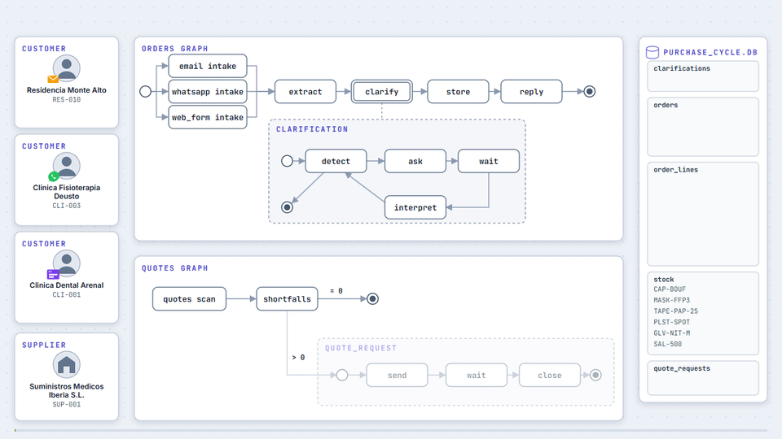
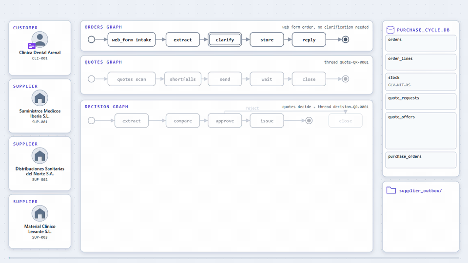
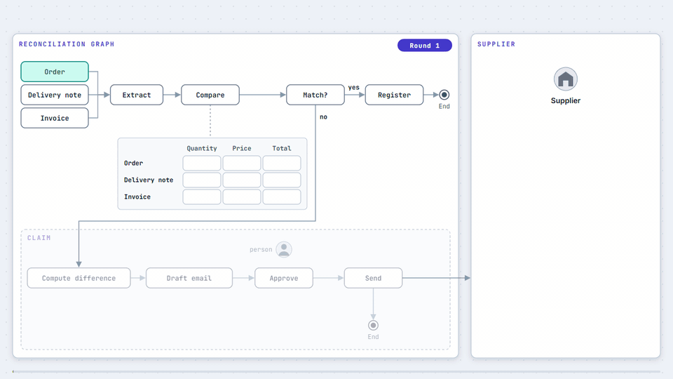

# Full Purchase Cycle Agents

Portfolio project that demonstrates multi-agent orchestration with [LangGraph](https://github.com/langchain-ai/langgraph) (Python) over the full purchase cycle of a fictional company.
Status: phase 01 (foundations) built: shared database, model client, persistent graph state, tracing and the evaluation harness.
Phase 02 (web form orders) integrated (merged via PR #4): the first order channel, from a form submission to a stored order and a reply.
Phase 03 (email orders) integrated (merged via PR #5): the email channel, from an `.eml` file with its body and PDF or Excel attachments to a stored order and a reply.
Phase 04 (exceptions) integrated (merged via PR #6): both channels ask the customer about ambiguous products, unknown products and doubtful quantities, pause with their state saved and resume when the answer arrives; its LangSmith trace evidence is pending.
Phase 05 (closing the orders module) integrated (merged via PR #9): a simulated WhatsApp channel, a deterministic router over a mixed inbox, idempotent storage, retries, re-asks, parked failures and crash recovery, with four new evaluations; its LangSmith trace evidence is pending.
Phase 06 (quote requests and wait) integrated (merged via PR #11): quote requests for products short of stock, supplier emails, a simulated clock and a multi-day wait with one reminder and a deadline, with no model call.
Phase 07 (quotes, decision) is built and delivered for review via PR: offer extraction with Claude Haiku 4.5, a fixed comparison rule, a human approval after a pause with saved state and an issued purchase order, with two new evaluations.
Phase 08 (reconciliation, detection) is built and delivered for review via PR: supplier invoices and delivery notes in text, PDF and Excel are read with Claude Haiku 4.5, linked to a purchase order, matched in plain code with a stated tolerance and stored with each difference, with two new evaluations; its LangSmith trace evidence is pending.
Phase 09 (reconciliation, claim) is built and delivered for review via PR: a claim email to the supplier is drafted with Claude Haiku 4.5, checked by code, approved, edited or rejected by a person after a pause with saved state, and written to the outbox, with two new evaluations; its LangSmith trace evidence is pending.
Phase 10 (goods receipt and serving) is built on its branch, not yet delivered: a reconciled supplier delivery note puts its goods into stock, the waiting customer orders that stock covers are served and a customer delivery note is written as a local file, in plain code with no model call and one new evaluation; its LangSmith trace evidence is pending.



The same animation as a video: [docs/assets/purchase-cycle-flow.mp4](docs/assets/purchase-cycle-flow.mp4).

It is a conceptual flow: today the channels run as separate graphs and the quotes graph starts from its own command until the orchestrator of phase 12.



The quotes part as a video: [docs/assets/quotes-flow.mp4](docs/assets/quotes-flow.mp4).
Like the one above, it is a conceptual flow, not the exact current behavior of the code.

## What it does

| Module | Flow | Capabilities shown |
|---|---|---|
| Customer orders | Email (text, PDF, Excel), web form and simulated WhatsApp; extraction, catalog matching, exceptions and reply | Per-channel subgraphs, pause until the customer answers, database |
| Supplier quotes | Out of stock, quote requests, multi-day wait with saved state, comparison and human approval | Persistent state, human-in-the-loop, resumption |
| Reconciliation | Order, delivery note and invoice on the purchase side (supplier) and the sales side (customer), differences and a claim or credit note approved by a person; goods receipt and serving of customer orders | Structured validation, human-in-the-loop |
| Orchestrator | Top-level graph composing the three modules over the shared database | Subgraph composition, failure recovery |

Every module will have a runnable demo, tests, an evaluation with metrics over a set of cases, and traces in LangSmith.
The plan and its phases live in [docs/plans/0_plan_maestro.md](docs/plans/0_plan_maestro.md).

## How it is built

The project is developed with the SDD Lite method: a master plan, phases with frozen acceptance criteria, autonomous agent execution and adversarial review.
The method guide (in Spanish) is [docs/como-trabajar.md](docs/como-trabajar.md).
`npm run check` groups all checks; the method's guardrails live in `.claude/settings.json` and `.claude/hooks/`.

## Requirements

Windows, Python 3.13 with uv, Node.js 22 (method tooling), Git and GitHub CLI.

## Setup

```
uv sync
npm ci --ignore-scripts --no-audit --no-fund
```

Nothing else is needed to run the checks: `npm run check` replays stored model answers and needs no API key and no `.env` file.

To call the real model, copy `.env.example` to `.env` and fill it in:

- `ANTHROPIC_API_KEY`: an Anthropic API key that belongs to a workspace.
- `LANGSMITH_API_KEY`, `LANGSMITH_TRACING=true` and `LANGSMITH_PROJECT`: optional; with them, live runs are traced in LangSmith. `LANGSMITH_ENDPOINT` is only needed for EU accounts.

## Seed the database

```
uv run purchase-cycle seed
```

Creates `data/purchase_cycle.db` (SQLite) with the shared tables and the permanent fictional catalog: 303 products in 32 families of a Spanish medical supplies distributor, and 50 customers (clinics, care homes and pharmacies).
Re-running it leaves the same rows.

## Run the demo

```
uv run purchase-cycle demo
uv run purchase-cycle demo "Could you send 6 bottles of 70% alcohol, 250 ml?" --mode live
```

The minimal graph has two nodes: `extract` asks Claude Haiku 4.5 for the product SKU and quantity, validated by a Pydantic schema, and `match` loads the product from the database.
The default `--mode replay` answers from stored recordings; `--mode live` calls the model and `--mode record` also stores the answer.
The catalog part of the prompt is cached, and the demo prints the cached tokens it read.
Every run is checkpointed in `data/checkpoints.db` under a `thread_id`; `--thread-id <id> --resume` continues a run stopped after a node completed, for example after `extract`, from that checkpoint without calling the model again; a run stopped inside `extract` calls the model again.
With the LangSmith variables set, live runs appear in LangSmith with one span per node; replay runs never send traces.

## Run the web form demo

```
uv run purchase-cycle web-form-demo
uv run purchase-cycle web-form-demo examples/web_form_submission.json --mode live
```

The web form is simulated as a JSON submission file: a submission id, a customer code and 1 to 20 lines, each with the product text the customer typed (up to 200 characters) and a quantity in catalog sale units.
The default file is `examples/web_form_submission.json`.
The `web_form_order` subgraph has four nodes:

- `validate` checks the submission with Pydantic and the customer code against the database; a rejected submission stops here with a message naming the failing field, with no model call and nothing stored.
- `match` resolves each line to a SKU: a catalog SKU or catalog name, ignoring case, accents, extra spaces and punctuation, is matched with no model call; any other text goes to Claude Haiku 4.5 with the cached catalog, which returns a SKU or null.
- `store` writes one order with channel `web_form` and status `received` and one order line per matched line, in a single transaction; a submission with no matched line stores no order.
- `reply` fills a fixed template from the stored rows, so every price comes from the database, and lists the lines that could not be matched with the text the customer wrote.

The demo prints, per line, the matched SKU and whether it came from deterministic matching or the model, then the stored order number and the reply.
`--mode replay` (the default) needs no key, because the sample file reuses texts of the evaluation dataset; `--mode live` calls the model and prints the cached tokens.
Every run is checkpointed in `data/checkpoints.db` under a `thread_id`; `--thread-id <id> --resume` continues a run stopped after a node completed, for example after `match`, from that checkpoint, so the order is stored once and the matched lines are not sent to the model again.
A run stopped inside `match` (an API error, a missing recording or Ctrl+C) re-runs `match` on resume and sends its model lines again.

## Run the email demo

```
uv run purchase-cycle email-demo
uv run purchase-cycle email-demo examples/email_orders --mode live
```

The demo reads every `.eml` file of a folder; the default folder `examples/email_orders/` holds four emails: an order in the body (`EML-0024.eml`), an order in a PDF attachment (`EML-0001.eml`), an order in an Excel attachment (`EML-0012.eml`) and an email that is not an order (`EML-0002.eml`).
The `email_order` subgraph has four nodes:

- `intake` parses the email with the standard library, finds the customer by the sender address and reads the body and the `.txt`, `.pdf` and `.xlsx` attachments; an unknown sender, an unreadable file or an over-long text stops here with no model call; then Claude Haiku 4.5 decides whether the email is an order and gives a reason.
- `extract` runs only for orders: the model returns every ordered line with the customer's text, a catalog SKU or null, the quantity in sale units and its source (`body` or the attachment name); a SKU outside the catalog, a non-positive quantity or an unknown source stops the run before anything is stored.
- `store` writes one order with channel `email` and status `received` and one order line per matched line, in a single transaction; an email with no matched line stores no order.
- `reply` fills the phase 02 template addressed to the sender, quoting the subject, with prices from the database and the lines that could not be matched.

The demo prints, per email, the intake decision and its reason, each line with its text, SKU and source, the stored order number and the reply.
`--mode replay` (the default) needs no key, because the sample emails are copied from the test split of the evaluation dataset and their recorded answers are reused; `--mode live` calls the model and prints the cached tokens of both calls.
Each email runs in its own checkpoint thread in `data/checkpoints.db`.

## Run the exceptions demo

```
uv run purchase-cycle exceptions-demo
uv run purchase-cycle clarify list
uv run purchase-cycle clarify answer <thread_id> --file examples/exceptions/web_form_answer.txt
uv run purchase-cycle clarify answer <thread_id> --text "The caps are the bouffant caps. Please drop the hospital beds." --mode live
uv run purchase-cycle clarify close <thread_id>
```

Every order channel (web form, email and WhatsApp) now has a `clarify` step, the shared `clarification` subgraph, between understanding the order (`match` or `extract`) and `store`:

- `detect` applies deterministic rules to every line: an ambiguous product when the line text fits two or more catalog products by a search over catalog names (up to 6 candidates), also when the matcher or extractor already gave it a SKU, an unknown product when the line has no SKU and the search finds nothing, and a doubtful quantity above 500 sale units or, for the free-text channels (email and WhatsApp), not supported by any number in the source text.
- `ask` has Claude Haiku 4.5 draft one question for all the doubtful lines; a deterministic check rejects a question that does not name every doubtful line with the text the customer wrote and every candidate name.
- `wait` pauses the run with LangGraph `interrupt`; the state stays in the SQLite checkpointer `data/checkpoints.db` and a `pending` row in the `clarifications` table, and nothing is written to `orders` or `order_lines`.
- `interpret` has the model read the customer answer into, per doubtful line, a SKU and quantity, a removal or "still unclear"; a missing or repeated line, a SKU outside the catalog or a non-positive quantity is rejected and the same question keeps waiting.
- Lines still unclear get a second question; after the second round the clear and resolved lines are stored in one transaction and the reply lists removed and unresolved lines with the text the customer wrote.

An order with no doubt goes straight through `clarify` with no model call and no pause, as in phases 02 and 03.

`exceptions-demo` runs the two samples of `examples/exceptions/`: a web form submission (`web_form_submission.json`, an ambiguous gel and a quantity of 1,200) and an email (`email_order.eml`, ambiguous caps and hospital beds not in the catalog).
For each one it prints the lines, the doubts found, the question and the thread id, and stops; the thread id starts with a new run id on every run, so copy it from the output, which also prints the full `clarify answer` command.
The other commands run as separate processes, so the pause survives the end of the demo process:

- `clarify list` shows every paused thread with its channel, customer, round and age.
- `clarify answer <thread_id> --text "..."` or `--file <path>` resumes the thread with the customer answer and prints the interpretation, the stored order number and the reply, or the second question; `examples/exceptions/web_form_answer.txt` and `email_answer.txt` are sample answers for the two samples.
- `clarify close <thread_id>` closes a thread with no answer: it stores the clear lines, lists the rest in the reply as unanswered and marks the row `closed`.

Answering or closing a thread that is not pending fails with a message and changes nothing.
`--mode replay` (the default) needs no key: the channel steps replay the detection evaluation recordings and the question and interpretation of the samples and their sample answers are recorded in `evals/recordings/`; any other answer text needs `--mode live`.
`--mode live` on `exceptions-demo` and on `clarify answer` calls Claude Haiku 4.5 and prints the cached tokens; with the LangSmith variables set the run is traced, and the pause and the resumption share the thread id (the phase 04 trace evidence is still pending, see Limits).

## Run the WhatsApp demo

```
uv run purchase-cycle whatsapp-demo evals/datasets/whatsapp_order_extraction/messages
uv run purchase-cycle whatsapp-demo <folder> --mode live
```

WhatsApp is simulated by files: each message is one `.json` file with `message_id`, `from` (the phone number), `timestamp`, `type` and `text.body`, and each reply is a `.json` file written to an outbox folder (`data/outbox/` by default, `--outbox <folder>` to change it).
The `whatsapp_order` subgraph mirrors the email one:

- `intake` reads the file, finds the customer by the digits of the phone number and rejects an unknown number, a malformed file or a message that is not text with no model call; a non-text message from a known customer gets a reply asking for the order as text; then Claude Haiku 4.5 decides whether the message is an order.
- `extract` returns every ordered line with the customer's text, a catalog SKU or null and the quantity in sale units; the only valid source of a line is `message`.
- `clarify`, `store` and `reply` are the shared phase 04 step, the idempotent store with channel `whatsapp` and the reply written to the outbox as `reply-<phone digits>-<message_id>.json`.

The demo runs every `.json` file of a folder and prints, per message, the sender and customer, the intake decision, the lines, the stored order number, the outbox file and the reply.
`--mode replay` (the default) needs no key for the 160 messages of the WhatsApp dataset, whose answers are recorded; any other message needs `--mode live`.
The demo has no clarification pause; the router below runs the full graph with its questions.

## Route a mixed inbox

```
uv run purchase-cycle route <folder> --mode live
uv run purchase-cycle route <folder> --mode live --run-id <run_id> --outbox <folder>
```

`route` reads one inbox folder holding web form `.json` submissions, `.eml` emails and WhatsApp `.json` messages, and sends each item to its graph.
The router is deterministic and calls no model: a `.eml` file goes to the email graph, a JSON file with `submission_id` to the web form graph and a JSON file with `message_id` and `from` to the WhatsApp graph; any other item is rejected with a reason.
A WhatsApp text from a known customer whose most recent pending clarification is a WhatsApp thread is the answer to that thread (route `whatsapp_answer`); any other WhatsApp message starts a new order (route `whatsapp_new`).
Storage is idempotent: the table `order_sources` keeps the channel's message id (the submission id, the email `Message-ID` or a hash of its content, the WhatsApp `message_id`) of every stored order.
A re-delivered message already stored for the same customer is route `duplicate`: no graph runs, no row is written and the customer gets the channel reply naming the stored order again; the same id from another customer is rejected.
A re-delivered message of a paused order, or a WhatsApp answer already applied to a thread of the same customer (pending or finished), is a duplicate too.
Each item runs in its own checkpoint thread `<channel>-<run_id>-<file stem>`; `--run-id` fixes the run id, which is random by default.
A new item whose thread id already has a checkpoint (a run id reused with the same file name) is not run: it fails with an error asking for a new `--run-id`.
In `--mode replay` an item runs only when every model answer it needs is recorded; `route` reads the per-task recordings of phases 01 to 04, not `evals/recordings/orders_demo.jsonl`, so the sample inbox is replayed through `orders-demo` below; an item with no recording stops with exit 1 and names the missing recording.

## Recovery from failures

```
uv run purchase-cycle failures list
uv run purchase-cycle failures resume <thread_id>
uv run purchase-cycle resume <thread_id>
```

Every model-calling step (matching, intake, extraction, question and interpretation) recovers in three ways:

- Transient errors (connection, timeout, rate limit and 5xx errors of the Anthropic API) are retried by a LangGraph retry policy, 3 attempts with exponential backoff; an authentication or other client error is not retried.
- An answer that breaks its schema or the validation rules (a SKU outside the catalog, a non-positive quantity, a line source outside its message) is asked again once with the validation error.
- A second invalid answer, or a transient error on the last attempt, parks the thread in the `failures` table as `needs_review` with nothing stored; a WhatsApp customer gets a notice in the outbox (`parked-<phone digits>-<message_id>.json`).

`failures list` shows every parked thread with its channel, source, step, age and first error line.
`failures resume <thread_id>` runs a parked thread again from its last checkpoint, for example after the outage is over, and marks its row `resolved` when the order completes; a thread that is not parked fails with a message and changes nothing.
A parked thread is resumed by an operator, never automatically.

`resume <thread_id>` continues any thread that `route` started and a crash interrupted.
Graph state is checkpointed after every step with synchronous durability, so a crash loses at most the step that was running, and the idempotent store makes a step that runs twice store one order.
The variable `PURCHASE_CYCLE_CRASH_AT` simulates a crash for tests and demos: set to `after_channel_steps`, `after_store_commit` or `in_reply`, it stops the process at that point with exit code 70.
For example, the web form in `examples/orders/crash/` uses exact SKUs and needs no model call, so this runs offline:

```
PURCHASE_CYCLE_CRASH_AT=after_store_commit uv run purchase-cycle route examples/orders/crash --run-id demo1
uv run purchase-cycle resume web_form-demo1-08-web-form-crash
```

The first command exits with code 70 right after the order is committed; the second finds the stored order through its source, finishes the run and prints the order number and the reply.
`resume` refuses a thread that waits for a customer answer, a parked thread (use `failures resume`) and the threads of the single-channel demos, which have no channel prefix.
`failures resume` and `resume` take `--mode`, `--checkpoints` and `--outbox` like `route`.

## Run the orders demo

```
uv run purchase-cycle orders-demo
uv run purchase-cycle orders-demo examples/orders --mode record --workdir data/orders-demo-record
```

`orders-demo` runs the sample mixed inbox `examples/orders/` through the router with the recovery scenes, on a fresh database, checkpoints and outbox in `data/orders-demo/` (`--workdir <folder>` to change it) on every run:

- `01-web-form.json`: a web form order; the first matching call fails with a connection error and the retry policy runs the step again.
- `02-email-order.eml`: an email order; the first extraction answer breaks its schema and the step asks again with the validation error.
- `03-whatsapp-order.json`: a WhatsApp order, stored with its reply in the outbox.
- `04-whatsapp-doubt.json`: a WhatsApp order with a doubtful line; the question goes to the outbox and the thread pauses.
- `05-whatsapp-photo.json`: an image message, rejected with the reply asking for text.
- `06-whatsapp-order-again.json`: a re-delivery of message 03, route `duplicate`, with the reply naming the stored order and nothing stored.
- `07-whatsapp-answer.json`: the customer's answer to message 04, route `whatsapp_answer`, which completes that order.
- `crash/08-web-form-crash.json`: a first process stops with `PURCHASE_CYCLE_CRASH_AT=after_store_commit` right after the order is committed, and a second process runs `purchase-cycle resume` on the thread.

The demo prints, per item, the channel, route, scene, outcome, order number and reply, then a summary of stored orders and parked failures.
`--mode replay` (the default) needs no key: the model answers are recorded in `evals/recordings/orders_demo.jsonl`.
`--mode live` calls Claude Haiku 4.5 and `--mode record` also stores the answers; the expected result is five stored orders and no parked failure.

## Request supplier quotes

The quotes module (`src/purchase_cycle/quotes.py`) asks suppliers for quotes when stored orders need more units than the stock holds.
Demand per SKU is the sum of the order lines of orders with status `received`; the shortfall is demand minus `stock.on_hand` minus the units of every earlier request for the SKU, waiting or closed.
`quotes scan` starts one quote request `QR-NNNN` per SKU with a positive shortfall and no request already waiting, for that shortfall, so a scan with no new orders starts nothing; it writes one request email per supplier of the product family to the supplier outbox (`data/supplier_outbox/`).
Three fictional suppliers live in `src/purchase_cycle/suppliers.py`; every product has at least two.
Each request is a LangGraph thread `quote-QR-NNNN` with the nodes `send`, `wait` and `close`, saved in the checkpoint file, so the wait survives the end of the process.
A supplier reply is an `.eml` file whose subject names the request reference and whose sender is a supplier of that request; receiving it only marks the supplier as replied, and the offer is read later by `quotes decide`.
The wait schedule: one reminder on day 3 to the suppliers that have not replied, and a deadline on day 5.
A request closes as `ready_for_decision` when every supplier replied, or at the deadline with at least one reply; with no reply it closes as `no_offers` and is parked in `failures` with step `quote_wait`.

### The simulated clock

Days pass on a simulated clock, one current time in the `sim_clock` table, which starts at 2026-10-12 09:00 on seed.
Nothing in the quotes code reads the real time: the clock moves only with `clock advance`, and waiting requests see it only when `quotes tick` delivers it.
A tick at or after the reminder time sends the reminder; a tick at or after the deadline closes the request.

### Commands

```
uv run purchase-cycle clock show
uv run purchase-cycle clock advance --days 3
uv run purchase-cycle clock advance --hours 6
uv run purchase-cycle quotes scan
uv run purchase-cycle quotes receive examples/quotes/replies-day-1
uv run purchase-cycle quotes tick
uv run purchase-cycle quotes list
```

- `clock show` prints the simulated time; `clock advance` moves it forward by `--days N` or `--hours N`.
- `quotes scan` starts the requests and writes the request emails.
- `quotes receive <folder>` reads the reply files of a folder in name order; a reply to an unknown or closed request, from a sender that is not a supplier of the request or from a supplier that already replied is rejected with its reason and changes nothing.
- `quotes tick` delivers the simulated time to every waiting request, which sends the due reminders and closes the requests past their deadline.
- `quotes list` prints every request with its status, replied and pending suppliers, next reminder and deadline.

Every command takes `--db <path>` before the command name; `scan`, `receive` and `tick` take `--checkpoints`, and `scan` and `tick` take `--outbox` for the supplier emails.
Running `scan` or `tick` twice at the same simulated time writes nothing new.
A `scan` also finishes the request emails of a request whose send failed partway, for example on a full disk, without writing any email twice.

### Decide and order

Phase 07 adds the decision step to the quotes module (`src/purchase_cycle/quote_decision.py`): it reads the replies of a request that is `ready_for_decision`, compares the offers, waits for a person and issues one purchase order.
Each request has its own LangGraph thread `decision-QR-NNNN`, separate from the wait thread, with the nodes `extract`, `compare`, `approve`, `issue` and `close` and the same SQLite checkpoint file.

- `extract` makes one call per replied supplier to Claude Haiku 4.5 (task `offer_extraction`, through the same client as the order channels, in live, record and replay modes). The prompt holds the request SKU, product name, sale unit and quantity and the reply body; the model returns whether the reply offers or declines, the quantity offered in sale units, the unit price per sale unit (converted from a price per pack or per piece), the currency, whether the price includes VAT and the VAT rate, the lead time and whether it counts working days, and the price text as written. Each offer is stored in `quote_offers`. A re-run reads the stored offers back and calls the model only for replies with no row.
- Usability is computed in code, never by the model. An offer is usable when it offers, with a positive quantity, a positive price, currency EUR, a lead time and a net price that can be computed (a price with VAT included needs the stated rate). Any other offer is stored as unusable with one reason: `declined`, `no_price`, `currency`, `no_lead_time`, `vat_rate_missing` or `extraction_failed`. An answer that does not fit the schema is stored as `extraction_failed` and parks one `failures` row (`needs_review`, step `offer_extraction`); the other replies go on.
- `compare` is deterministic and calls no model (the comparison rule below).
- `approve` pauses with a LangGraph `interrupt` until a person answers. The request is `awaiting_approval` and the state stays in the checkpoint file, so the pause survives the end of the process.
- `issue` writes the purchase order and its email; `close` closes a rejected request. Both are idempotent: a unique purchase order per request and keyed outbox file names prevent duplicates when the graph resumes.

#### The comparison rule

- Unusable offers are left out of the recommendation and shown with their reason.
- Offers that cover the full requested quantity come first; among them the lowest total wins, where the total is the net unit price (before VAT) times the requested quantity.
- A tie goes to the shorter lead time in calendar days from the decision date, then to the lower supplier code. Working days count Monday to Friday with no holidays and weeks count as 7 days.
- A partial offer is recommended only when no usable offer covers the full quantity; among partial offers the same order applies, with the total over the offered quantity.
- No order is split between suppliers. The recommendation carries a reason text from a fixed template that names the deciding rule and the compared totals.

#### Decision commands

```
uv run purchase-cycle quotes decide
uv run purchase-cycle quotes approve QR-0001
uv run purchase-cycle quotes approve QR-0001 --supplier SUP-003
uv run purchase-cycle quotes reject QR-0001
```

- `quotes decide` starts the decision of every `ready_for_decision` request that has none yet and prints, per request, the offers with their usability, the recommended supplier and its reason; each request ends `awaiting_approval`. It then lists every `no_offers` request as waiting for a person, with no purchase order and no new request. A second `decide` starts nothing and calls no model. `--mode live|record|replay` (default replay) and `--recordings <file>` select how the extraction answers.
- `quotes approve QR-NNNN` approves the recommendation; with `--supplier SUP-NNN` it issues the order from that supplier's usable offer instead, full or partial. A supplier with no offer for the request or with an unusable offer is refused with a reason and the request stays waiting. A request with no usable offer accepts only `reject`.
- `quotes reject QR-NNNN` closes the request as `rejected` with no purchase order and no email.
- Any command on a request that is not `awaiting_approval`, including a second `approve`, fails with a message and changes nothing.
- `quotes list` also shows the new statuses `awaiting_approval`, `ordered` and `rejected`, the recommended supplier and the purchase order number.

`decide`, `approve` and `reject` take `--checkpoints`, `approve` also takes `--outbox`, and all take `--db` before the command name.

#### The purchase order

An approval writes one row in `purchase_orders` and moves the request to `ordered`.
The order has the number `PO-NNNN` (from the table id), the request, the supplier, the SKU, the quantity (the requested quantity for a full offer, the offered quantity for a partial one), the unit price before VAT, the currency, the total, the expected delivery date and the status `issued`.
The issue time comes from the simulated clock and the expected delivery date is the issue date plus the lead time, with working days counted Monday to Friday.
It also writes one email `PO-NNNN-<supplier code>.eml` in the supplier outbox from a fixed English template, with the order number and request reference in the subject and the SKU, product name, sale unit, quantity, unit price, currency, total and expected delivery in the body; nothing is sent.
Stock and customer orders are not changed: phase 08 brings the delivery note.

A local database made by phase 06 code has the old status check on `quote_requests`, which SQLite cannot widen in place, and `seed` keeps an existing file as it was: seed a new database file instead (`--db <new file>`, or delete the old database file and its checkpoint file).

### Run the quotes demo

```
uv run purchase-cycle quotes-demo
```

`quotes-demo` stores the two sample orders of `examples/quotes/orders.json` as `received` in a fresh database, checkpoints and supplier outbox in `data/quotes-demo/` (`--workdir <folder>` to change it), then runs eleven steps, each one as its own `purchase-cycle` process:

1. `quotes scan` on day 0 starts `QR-0001` (12 units of `GLV-NIT-XS`, three suppliers) and `QR-0002` (4 units of `GLV-SURG-NEO-6.5`, two suppliers) and writes five request emails.
2. `clock advance --days 1`.
3. `quotes receive examples/quotes/replies-day-1`: `SUP-002` replies to `QR-0001`.
4. `clock advance --days 2`.
5. `quotes tick` on day 3 sends four reminders, to the suppliers that have not replied.
6. `quotes receive examples/quotes/replies-day-3`: `SUP-003` replies to `QR-0001` after its reminder.
7. `clock advance --days 2`.
8. `quotes tick` on day 5 closes `QR-0001` as `ready_for_decision` and `QR-0002` as `no_offers`.
9. `quotes decide` extracts the two offers of `QR-0001` (`SUP-002` offers all 12 boxes at 4.10 EUR in 5 working days, `SUP-003` only 8 boxes at 3.95 EUR in 7 working days), recommends `SUP-002` because it is the only offer that covers the full quantity, and leaves the request `awaiting_approval`; `QR-0002` is listed as waiting for a person.
10. `quotes approve QR-0001` stands for the operator: it issues `PO-0001` to `SUP-002` and writes `PO-0001-SUP-002.eml`.
11. `quotes list` shows `QR-0001` as `ordered` with its order and `QR-0002` as `no_offers`.

The demo prints, per step, the simulated time, the requests started, the emails written, the replies received and the status of every request, then a summary after the wait steps (as in phase 06) and a decision summary; the decision steps also print the offers, the recommendation and its reason, and the order.
By default (`--mode replay`) it reads the offer extraction answers from `evals/recordings/quotes_demo.jsonl` and needs no key and no network.
To record them again, set `ANTHROPIC_API_KEY` in `.env` and run `uv run purchase-cycle quotes-demo --mode record` (two Haiku 4.5 calls, a fraction of a cent); `--mode live` calls the model without saving.


## Reconcile supplier invoices

The reconciliation module (`src/purchase_cycle/reconciliation.py` and `src/purchase_cycle/reconcile_match.py`) reads the invoices and delivery notes that suppliers send after a purchase order and compares them with that order.
Only the reading is done by the model: Claude Haiku 4.5 extracts the kind, number, purchase order reference, date, currency, supplier and lines of one document from its text (`.txt`, text `.pdf` and `.xlsx`; the file name is never sent).
Everything after the extraction is plain code: linking, matching and storage.

A document is linked to the purchase order named by its `PO-NNNN` reference.
It is stored as `unlinked` with a reason when the reference is missing (`no_reference`), names an unknown order (`unknown_order`), comes from another supplier than the order has (`supplier_mismatch`) or repeats an invoice or delivery note already linked to that order (`duplicate`).
A document the model cannot read is stored as `extraction_failed` and parked in `failures`, and the scan goes on with the next file.
Each file is identified by the SHA-256 of its content, so scanning the same folder twice reads and stores nothing new and calls no model.

### Matching rules and tolerance

The reconciliation belongs to an invoice, is named `INV-NNNN` after the invoice document and compares it with the order and, when it exists, the delivery note of the same order.
Prices are compared before VAT in EUR.
The price tolerance is 0.01 EUR per unit and the quantity tolerance is 0.
A difference is stored with its type, SKU, expected and found values, the amount per unit and the total amount:

- `price`: the invoice unit price differs from the order price by more than the tolerance.
- `quantity`: the invoiced quantity differs from the ordered quantity or, if there is a delivery note, from the delivered quantity.
- `extra_line`: an invoice line whose SKU is not in the order, or whose text matches no catalog product.
- `missing_line`: the order SKU is absent from the invoice.

Three rules complete the list:

- An invoice line of the order SKU with no stated price is a `price` difference with no found value and no amount, never a match.
- Repeated lines of the same SKU are checked one by one.
  The `price` row holds the lines outside the tolerance and follows the line with the largest deviation: its found price and unit deviation, and the amount of the off-tolerance lines that deviate in the same direction.
  Opposite deviations never cancel each other out.
- When the invoiced quantity differs from both the order and the delivery note, the larger difference is stored and the other reference is not kept, because there is one `quantity` row per SKU.
- A delivery note that exists but has no line for the invoiced order SKU counts as delivered quantity 0, so the invoiced quantity is a `quantity` difference against the note and the user checks whether it was delivered before paying.
  This also holds when the note's lines could not be resolved to a SKU: an unresolved note line is not matched to the order SKU and is not reported as a difference of its own.

The result is `matched` with no difference, `discrepancies` with at least one, and `awaiting_delivery_note` while no delivery note exists yet.
A delivery note scanned later completes the same reconciliation to `matched` or `discrepancies` and never adds a second one.
The order in which files are read does not change the result, and no model is called during matching.
Differences are detected and stored in plain code; phase 09 adds the claim step below.

### Reconcile commands

```
uv run purchase-cycle reconcile scan FOLDER [--mode replay|record|live] [--recordings FILE]
uv run purchase-cycle reconcile list
uv run purchase-cycle reconcile show INV-0001
```

`reconcile scan` reads the new files of a folder, in sorted order, and prints one line per file with its kind, state and result.
`reconcile list` prints the counts by result and by difference type, one line per reconciliation with its own count per difference type, and a "not reconciled" section with the documents that are unlinked, unreadable or still extracted, each with its stored reason.
Delivery notes that are linked to an order but have no invoice yet are not listed.
`reconcile show` prints the result, the order, the delivery note and each difference; an unknown reference exits 1 with a message.
Every command accepts `--db` and `--checkpoints`; `scan` defaults to `--mode replay`.
The state is in the database, so each command can run in its own process.

### Run the reconcile demo

```
uv run purchase-cycle reconcile-demo
```

`reconcile-demo` starts from a fresh database in `data/reconcile-demo/` (`--workdir <folder>` to change it), seeds the seven purchase orders of `examples/invoices/purchase_orders.json`, and runs each step as its own `purchase-cycle` process: `reconcile scan examples/invoices/documents`, `reconcile list`, a `reconcile show` per reconciliation, then `reconcile scan examples/invoices/later` with the delivery note that was held back, `reconcile list` and the `reconcile show` of the reconciliation that changed.
The 15 sample documents are in the three formats and cover a matched invoice with its delivery note (`INV-0006`), a price difference (`INV-0007`), a quantity difference (`INV-0008`), an extra line (`INV-0009`), an extra and a missing line (`INV-0010`), an invoice without delivery note that the second scan completes to `matched` (`INV-0011`), an invoice (`INV-0014`) that still waits for its delivery note at the end, a document with an unknown order and one from the wrong supplier.
It prints the extracted documents with their lines, the result of every invoice and the classified differences, and exits non-zero unless it ends with a matched invoice, every difference type, a completed reconciliation, an unlinked document and exactly one invoice still awaiting its delivery note.
By default (`--mode replay`) it reads the extraction answers from `evals/recordings/reconcile_demo.jsonl` and needs no key and no network; a test inside `npm run check` runs it with the network blocked.
To record them again, set `ANTHROPIC_API_KEY` in `.env` and run `uv run purchase-cycle reconcile-demo --mode record` (15 Haiku 4.5 calls, a few cents); `--mode live` calls the model without saving.



The reconciliation flow as a video: [docs/assets/reconcile-flow.mp4](docs/assets/reconcile-flow.mp4).
Like the orders and quotes animations, it is a conceptual flow, not the exact current behavior of the code: it shows five of the seven reconciliations of the demo.

## Claim a supplier for invoice differences

Phase 09 turns the differences of an invoice into a claim email that a person approves.
It is a `claim` graph (`src/purchase_cycle/claims.py`) with the nodes `draft`, `review`, `send` and `close`.
The `review` node (`src/purchase_cycle/review.py`) is side-agnostic: it only pauses with a message and returns the decision (approve, edit or reject) and the final text, and imports nothing of suppliers, invoices or the database, so a sales-side claim can reuse it.
Matching, the stored differences and the purchase orders are never changed by a claim command.

### What a claim holds

A claim exists for every reconciliation in `discrepancies` that has none; invoices that are `matched`, `awaiting_delivery_note` or unlinked get no claim.
An invoice that a later delivery note moves to `discrepancies` becomes a candidate on the next `reconcile claims`.
The facts are the supplier, the supplier invoice number, the purchase order, the `INV-NNNN` reference and every stored difference.
The amount in dispute is the sum of the positive `price` and `quantity` amounts and of the priced `extra_line` rows, rounded to cents.
Negative rows and `missing_line` rows (in our favour) are listed for correction and not added, and a row with no amount is listed with no amount.
Recipient, subject (`Claim on invoice <number> for purchase order <PO>`) and sender are set by code, never by the model.

### Drafting, fact check and template

Claude Haiku 4.5 writes only the body, in one call per claim.
Plain code then checks the draft: it must name the invoice and order references, every difference by SKU or product text, every difference amount, the amount in dispute and a request for a corrected invoice or credit note; an amount that is not in the facts, non-ASCII text or an over-long body fails.
The amount in dispute must appear in a sentence that mentions the dispute, and each row amount in the segment of its own item.
Amounts are read with an optional euro sign or EUR and with thousands separators, and references and item names must match on token boundaries.
When the answer is invalid after retries or the check fails, a fixed template filled from the facts is used, the claim is stored with source `template` and one `failures` row (`needs_review`, step `claim_drafting`) is written, and the next claim is still drafted by the model.
Each claim is stored with its draft, source (`model` or `template`), status and decision.

### Claim commands

```
uv run purchase-cycle reconcile claims
uv run purchase-cycle reconcile approve INV-0007 [--body-file FILE] [--outbox DIR]
uv run purchase-cycle reconcile reject INV-0007
```

`reconcile claims` drafts one claim per candidate, prints the draft, the facts and the source, and leaves each claim `awaiting_approval` with its thread `claim-INV-NNNN` paused in the checkpoint file.
A second run drafts nothing and calls no model.
`approve` sends the draft as it is, or the text of `--body-file` (marked edited; an empty file is refused), by writing one `.eml` to the supplier outbox, and sets the claim to `sent`.
`reject` closes the claim with no email.
A second decision, an unknown reference or an invoice with no claim exits 1 with a message.
An `approve` or `reject` of a claim whose thread is missing from the checkpoints file rebuilds the thread from the stored claim, with no model call.
A claim outbox file of the same name with another text refuses the send and leaves the claim awaiting; `--body-file` cannot change a decision that is already being completed.
A decision resolves the `claim_drafting` row of `failures`; `failures resume` refuses it and points to `reconcile approve` or `reject`.
`reconcile list` shows the claim status of each invoice and `reconcile show` the draft, the final text, the source and the status.
`--db` is a global option placed before the subcommand and every command accepts it; `--checkpoints` is accepted by `scan`, `claims`, `approve` and `reject`, not by `list` or `show`; each command can run in its own process.

### Run the claim demo

`uv run purchase-cycle reconcile-demo` now continues after the phase 08 steps: `reconcile claims`, `reconcile list`, three decisions and a `reconcile show`, each as its own process.
One claim is sent as drafted, one is sent with the edited text of `examples/invoices/claim_edit.txt`, one is rejected and one is left awaiting approval; it ends with `claims: INV-0007=sent, INV-0008=sent edited, INV-0009=rejected, INV-0010=awaiting_approval` and exits non-zero otherwise.
In replay (the default) the four drafts come from `evals/recordings/claim_demo.jsonl`, with no key and no network.
To record them again, set `ANTHROPIC_API_KEY` in `.env` and run `uv run purchase-cycle reconcile-demo --mode record` (15 extraction calls and 4 drafting calls, a few cents); `--mode live` calls the model without saving; `--claim-recordings FILE` picks another claim recordings file.

## Receive goods and serve orders

Phase 10 closes the purchase side: a reconciled supplier delivery note puts its goods into stock, the customer orders that stock now covers are served, and a delivery note for the customer is issued.
It is a `receipt` graph (`src/purchase_cycle/receipts.py`) with the nodes `receive`, `serve` and `issue`, run by `receipts run`.
No model is called anywhere in this step; it is plain code over the tables of phases 06 to 09 and four new ones (`goods_receipts`, `goods_receipt_lines`, `customer_delivery_notes` and `customer_delivery_note_lines`).

### Receipt candidates and received quantities

A delivery note is a candidate when it is linked to a purchase order, a reconciliation of result `matched` or `discrepancies` references it, and it has no receipt yet.
A claim on the invoice concerns money and does not hold the goods, so a note whose invoice is under claim is received like any other.
An invoice `awaiting_delivery_note`, an unlinked document and a note with no invoice are not candidates; a note linked by a later reconciliation becomes one on the next run.
Receiving adds the delivered quantity of each line to `stock.on_hand`, whether it is short, exact or above the purchase order, and for a SKU that is not on the purchase order.
A note with an unknown SKU, a fractional or non-positive quantity or no lines adds nothing: it is stored as a `failed` receipt with its reason, one `failures` row (`needs_review`, step `goods_receipt`) is written, and the next note is still received.
Each note is received once, in one transaction with its stock change.

### Short deliveries and the quote scan

A short delivery is closed short: there is one delivery note per purchase order and no backorder.
`quotes scan` counts the units of a purchase order as still on their way until a receipt of that order exists; after a receipt they are in `stock.on_hand`, so a short delivery with orders still needing the SKU starts a new request for exactly the unreceived remainder, and an exact delivery that covers the orders starts none.
Without receipts the shortfall is the same as in phase 06.

### The allocation rule

`receipts run` serves the stored orders in `received` status in ascending order id, in one first pass.
An order is served only when stock covers every line; it then becomes `served`, its quantities leave `on_hand` and stock never goes below zero.
An order that is not fully covered is skipped with its missing units per SKU, stays `received` and waits for the next run; a later order that stock does cover is still served, so a large old order does not hold up the small ones behind it.
The pass runs on every `receipts run`, so an order that stock already covers is served even when the run received nothing.
There is no second pass within a run: a skipped order is looked at again only on the next run.

### The customer delivery note

Each served order gets one row `CDN-NNNN` with its lines and the sale unit of each product, and a text file `CDN-NNNN.txt` in `data/customer_delivery_notes/` (`--notes-dir` to change it).
The file holds the company, the delivery note number, the date from the simulated clock, the order as `ORD-NNNN`, the customer name, code and city, one line per SKU with name, quantity and sale unit, and a signature line.
It has no price and only ASCII characters (accents are dropped).
An existing file is not rewritten, and a missing file of a stored note is written again on the next run.
The file is a local text file: nothing is sent to the customer.

### Receipt commands

```
uv run purchase-cycle receipts run [--checkpoints FILE] [--notes-dir DIR]
uv run purchase-cycle receipts list
uv run purchase-cycle receipts show CDN-0001
```

`receipts run` prints each receipt (`RCP-NNNN`) with its delivery note, purchase order and units or failure reason, each served order with its note, each skipped order with its missing units and each file written, or `nothing changed`.
`receipts list` prints every receipt and every customer delivery note with its order and customer, and `receipts show` prints the text of one note; an unknown or malformed reference exits 1 with a message and changes nothing.
`--db` is a global option placed before the subcommand, and the state is in the database, so each command can run in its own process.
Each run is the thread `receipt-run-NNNN` in the checkpoint file; a run that stopped before its end is resumed by the next `receipts run`, which ends with the same rows, stock and files as an uninterrupted run.

### Run the receipt demo

```
uv run purchase-cycle receipt-demo
```

`receipt-demo` starts from a fresh database in `data/receipt-demo/` (`--workdir <folder>` to change it).
It seeds the seven purchase orders of `examples/receipts/purchase_orders.json` (the phase 08 file with the gauze order raised to 50 units so one delivery is short) and the five customer orders of `examples/receipts/customer_orders.json`, then runs each step as its own process: `reconcile scan examples/invoices/documents`, `receipts run`, `reconcile scan examples/invoices/later`, `receipts run`, `receipts list` and a `receipts show` of each note.
It prints the stock before and after each run, and ends with a summary of two receipts from matched invoices, four from invoices with discrepancies, one received only after the later scan, one short delivery, one order served after waiting for stock, one order skipped for lack of stock and no receipt for the two unlinked documents; it exits non-zero when any of these is missing.
By default (`--mode replay`) it reads the extraction answers from the phase 08 recording `evals/recordings/reconcile_demo.jsonl` and needs no key and no network; a test inside `npm run check` runs it with the network blocked.
`--mode record` and `--mode live` behave as in `reconcile-demo`.

### Limitations of the receipt step

- Whole orders only: an order waits until every line is covered, and no partial delivery or backorder is made.
- One delivery note per purchase order; a short delivery is closed short and the remainder is bought again through `quotes scan`.
- Serving is a first pass by ascending order id: an order skipped for lack of stock waits for the next `receipts run`, and a smaller later order may take the stock first.
- A delivery note that fails is stored as a `failed` receipt and parked once; it is never retried, so a corrected note needs a new document.
- `receipts run` resumes the highest unfinished `receipt-run-NNNN` thread before it starts a new one.
- Stock is a single number per SKU, with no reservation, location, lot or expiry.
- The customer delivery note is a local text file; nothing is sent to the customer.
- The delivered quantity read by the model goes into stock with no human check (SEC-022 in `docs/security.md`).
- The phase 08 limitations remain: one invoice and one delivery note per order, fixed tolerances, and the DOC-060 and DOC-112 extraction errors until their change lands.

## Watch the graphs in LangGraph Studio

```
LANGGRAPH_CLI_NO_ANALYTICS=1 uv run langgraph dev --allow-blocking
```

In PowerShell: `$env:LANGGRAPH_CLI_NO_ANALYTICS=1; uv run langgraph dev --allow-blocking`.
The local server starts on port 2024 and serves three graphs from `langgraph.json`: `web_form`, `email` and `whatsapp`.
`--allow-blocking` is needed because the graphs open SQLite inside the server's event loop.
Open Studio at `https://smith.langchain.com/studio/?baseUrl=http://127.0.0.1:2024`; it may ask for a free LangSmith login.
Pick a graph, paste the input for a sample and submit it to watch each node and the state after each step:

- `web_form`: `{"submission": {"submission_id": "WF-ORDERS-01", "customer_code": "CLI-001", "lines": [{"product": "nitrile gloves M", "quantity": 20}, {"product": "saline 500 ml", "quantity": 12}]}}`
- `email`: `{"email_path": "examples/orders/02-email-order.eml"}`
- `whatsapp`, clear order: `{"message_path": "examples/orders/03-whatsapp-order.json"}`
- `whatsapp`, doubtful order: `{"message_path": "examples/orders/04-whatsapp-doubt.json"}`; the run pauses on the clarification question, then resume it to store the order by typing the answer as plain text, `Size L please, all of them.`, in the resume box (delete the prefilled `""` first); `{"answer": "Size L please, all of them."}` works too.

Studio runs in replay mode by default and needs no key: the answers come from `evals/recordings/orders_demo.jsonl` plus `evals/recordings/studio.jsonl`.
`PURCHASE_CYCLE_STUDIO_MODE=live` calls Claude Haiku 4.5 instead, costs a few cents per run and needs `ANTHROPIC_API_KEY`.
LangSmith tracing is forced off in both modes.
The graphs use their own database and outbox under `data/studio/`, never `data/purchase_cycle.db` or the demo outboxes.

Live mode with your own messages:

- Start the server with `PURCHASE_CYCLE_STUDIO_MODE=live` set (in PowerShell: `$env:PURCHASE_CYCLE_STUDIO_MODE="live"` before the command above).
  The dev server does not load the project's dotenv file by itself, so live mode loads `ANTHROPIC_API_KEY` from it; tracing stays off.
- Put your messages in `data/studio/inbox/`, which Git ignores.
- WhatsApp: a JSON file shaped like `examples/orders/03-whatsapp-order.json`, with `from` set to the phone digits of a seeded customer, for example `34600103203` (Jon Arrieta, CLI-004).
  Input for the `whatsapp` graph: `{"message_path": "data/studio/inbox/<file>.json"}`.
- Email: an `.eml` file whose `From` is a seeded customer, for example `iker.cli-002@example.com`.
  Input for the `email` graph: `{"email_path": "data/studio/inbox/<file>.eml"}`.
- Use a new `message_id` (WhatsApp) or `Message-ID` (email) each time: a message already processed is recognized and returns the existing order.
- Each graph takes only its own channel's input: sending one channel's input to another graph fails with a `KeyError` naming the missing input key.

Limits:

- Studio threads live in the dev server and are separate from the CLI `clarify`, `resume` and `failures` commands.
- In replay only the recorded answer works; any other input or answer has no recording, so it needs live mode.
- Each sample can be stored only once per Studio database: running it again returns the order already stored.
  To replay a sample from scratch, stop the server and delete `data/studio/` and `.langgraph_api/`; the database is seeded again on next use (move your inbox files out first).

## Try the orders by hand

```
uv run purchase-cycle ui
```

Open `http://127.0.0.1:8765/` (`--port N` picks another port).
The page lists the catalog with stock and a text filter, and the seeded customers with the email and phone each channel uses to identify them.
Pick a channel and a customer, write the order and press Send:

- Web form: one line per product and quantity; the product box suggests names from the catalog.
- Email: a subject and a body, sent from the customer's email.
- WhatsApp: a text, sent from the customer's phone; the photo box sends an image message, which is answered as text only.

The page uses three columns on a wide screen, each scrolling on its own: the new order on the left, the catalog, stock shortfalls and database in the centre, the conversations on the right; on a narrow screen they stack in one column.
A stored order shows as an order block in its conversation, with its lines, amounts, stock and the lines short of stock.
The Database card shows the page's own tables (orders, order lines, stock, quote requests, quote offers, purchase orders), read only, with a Refresh button.
The "Check stock shortfalls" button starts one quote request per short SKU and puts the request emails in the outbox; it makes no model call.
A SKU whose earlier request is still waiting for supplier replies does not get a new one.
Supplier replies, the decision and the approval are not on the page.

Each send writes one input in the channel's own format under `data/ui/inbox/` and runs it through the router, as `purchase-cycle route` does.
The conversation list shows the route, the thread id, the outcome (stored order, question, not an order, rejected) and the reply the customer would get.

Modes:

- `--mode live` (default) calls Claude Haiku 4.5, needs the key in `.env` and understands free text; it costs a few cents per order.
- `--mode replay` costs nothing and needs no key, but only understands the recorded sample texts of `examples/orders/`: send those texts to see the same outcomes as `purchase-cycle orders-demo` (its recordings `orders_demo.jsonl`).

LangSmith tracing is always off, so the page spends no trace quota.

When the system asks a question, it shows in the conversation.
For a web form or email order, write the answer in the box under the question and press Answer; the paused order resumes and shows its outcome.
For WhatsApp, the answer is a new message from the same customer: use the button under the question, write the text and send it.

To start over, stop the server and delete the `data/ui/` folder; the next start seeds it again.
The page uses its own database, checkpoints and outbox under `data/ui/`, never the business database.

Limits:

- It is a local simulation: nothing is sent to a real WhatsApp, email or web channel, and the server accepts connections from this machine only.
- One request runs at a time; a live order waits for the model.
- Every send gets a new message id, so the page cannot re-deliver a message (the duplicate case of `examples/orders/06-whatsapp-order-again.json`).
- Email has no attachments and WhatsApp no media beyond the photo box.
- The conversation list is kept in `data/ui/conversations.jsonl`.

## Run the tests

```
npm run check
```

Runs the method's hook tests, ruff, pytest and the seventeen evaluations in replay mode.

## The golden dataset

The evaluation dataset is synthetic.
`evals/datasets/order_line_extraction/` holds 2,000 single-line order requests in eight categories of 250 cases (exact name, synonym, quantity in words, unit expressions, noise around the order, typos, near-miss variants and products not in the catalog), split into 500 development and 1,500 test cases, stratified by category.
Every catalog product appears in five or six cases.

How it was built:

1. `uv run purchase-cycle dataset plan` writes `plan.jsonl` from a fixed seed: the category, expected SKU, quantity and trap of every case are decided before any sentence exists.
2. The sentences in `sentences/` were written by the coding agent (Claude Code under the owner's subscription, not the API), following the plan, and checked with `uv run purchase-cycle dataset check <file>`.
3. `uv run purchase-cycle dataset build` joins plan and sentences, rejects cases that break the automatic rules (unknown SKU, non-positive quantity, duplicate sentence, category rule) and writes `dataset.jsonl`.
4. A blind second pass by clean-context agents labelled every sentence again and compared its labels with the plan; any disagreement is fixed before the owner audit (version 1.0 had none).
5. The owner audits 150 random cases plus a hand-written contrast set of 60 sentences (`contrast.jsonl`): `uv run purchase-cycle audit create`, fill the `verdict` column of `evals/audit/`, then `uv run purchase-cycle audit report`.
   The audit passes with at most 2 wrong labels in the sample; its result is recorded in the phase plan (`docs/plans/fase-01-cimientos/plan.md`).

The dataset only changes through these commands; the labels in `dataset.jsonl` must equal the plan, and a test checks it.

### Web form matching dataset

`evals/datasets/web_form_matching/` holds 624 form lines grouped into 225 submissions of 1 to 5 lines, in six categories of 104 lines: exact name, SKU typed, short or informal name, typo, near-miss variant and product not in the catalog.
The split is by submission, stratified by category: 156 development and 468 test lines.
Every catalog family appears and every product appears once or twice.

It was built with the same method:

1. `uv run purchase-cycle web-form-dataset plan` writes `plan.jsonl` from a fixed seed: the category, expected SKU (or an out-of-catalog item) and trap of every line, and its submission and split.
2. The exact name and SKU lines are produced by the script; the other four categories were written by the coding agent into `texts/` and checked with `uv run purchase-cycle web-form-dataset check <file>`.
3. `uv run purchase-cycle web-form-dataset build` joins plan and texts, rejects lines that break the automatic rules (unknown SKU, duplicate text after normalisation, category rule) and writes `dataset.jsonl`.
4. A blind second pass by clean-context agents relabelled every written line (`second_pass_review.jsonl`); version 1.0 had no disagreement with the plan.
5. The owner audited 60 random written lines: `uv run purchase-cycle web-form-audit create`, fill the `verdict` column of `evals/audit/web_form_matching-audit-v1.0.csv`, then `uv run purchase-cycle web-form-audit report`.
   The audit passes with at most 1 wrong label; version 1.0 had none (error rate 0.0%, 95% Wilson interval 0.0% to 6.0%).

### Email order extraction dataset

`evals/datasets/email_order_extraction/` holds 312 `.eml` files in six categories of 52 emails: list in the body, conversational body, `.txt` attachment, PDF attachment, Excel attachment and not an order.
They carry 923 expected lines, 92 of them for products not in the catalog; the split is by email, stratified by category: 78 development and 234 test emails.
PDF attachments use two layouts (order form and delivery note) and Excel attachments two more (header row and extra columns).

It was built with the same method:

1. `uv run purchase-cycle email-dataset plan` writes `plan.jsonl` from a fixed seed: the category, sender, order or not, and every line with its expected SKU or out-of-catalog item, quantity in sale units, unit expression, location and trap (typo or near-miss variant), before any text exists.
2. The email bodies and line texts in `texts/` were written by the coding agent following the plan and checked with `uv run purchase-cycle email-dataset check <file>`.
3. `uv run purchase-cycle email-dataset build` validates the texts (unknown SKU, non-positive quantity, duplicate text, a planned line missing from the rendered text, category rules), renders the `.eml` files and attachments deterministically and writes `dataset.jsonl`.
4. A blind second pass by clean-context agents read only the catalog and the text the model sees and labelled every email again (`second_pass_review.jsonl`); 2 of 312 emails disagreed with the plan and their texts were fixed.
5. The owner audited 40 random emails: `uv run purchase-cycle email-audit create`, fill the `verdict` column of `evals/audit/email_order_extraction-audit-v1.0.csv`, then `uv run purchase-cycle email-audit report`.
   The audit passes with at most 1 wrong label; version 1.0 had none, 40 of 40 correct (error rate 0.0%, 95% Wilson interval 0.0% to 8.8%).

### Clarification datasets

Two datasets evaluate the exceptions step:

- `evals/datasets/clarification_detection/` holds 200 orders, 100 web form submissions and 100 emails (`emails/`), with 620 lines: 70 lines per doubt type (ambiguous product, unknown product, doubtful quantity) and 64 orders with no doubt; each line carries its expected doubts.
  Email quantity doubts are 15 lines over the 500 ceiling and 20 lines with no stated number.
- `evals/datasets/clarification_answers/` holds 210 answer cases in six categories of 35: pick by size or variant, pick by description, give a quantity, remove a line, several lines at once, and still unclear or off topic; each case has its doubtful lines, the question sent and the customer answer, with the expected resolution per line (a SKU and quantity, a removal or still unclear).

Both are split by order or case, stratified by channel and doubt type or by category: 50 development and 150 test orders, 54 development and 156 test cases.
They were built with the same method as the earlier datasets:

1. `uv run purchase-cycle clarification-dataset plan --dataset detection` (or `--dataset answers`) writes `plan.jsonl` from a fixed seed: every line with its product or out-of-catalog item, quantity, doubt type and, for an ambiguous line, its candidate set, before any text exists.
2. The texts in `texts/` were written by the coding agent following the plan and checked with `uv run purchase-cycle clarification-dataset check --dataset <name> <file>`.
3. `uv run purchase-cycle clarification-dataset build --dataset <name>` judges every line with the runtime detection rules, as an ideal matcher or extractor would return it, and rejects a text that does not raise exactly its planned doubt and candidates, a planned line missing from the text, a broken quantity rule, a duplicate text or an answer naming a SKU it may not name; emails are rendered with the phase 03 renderer and `dataset.jsonl` is written only when nothing is rejected.
4. A blind second pass by clean-context agents read only the catalog and the texts (`second_pass_judgments/`) and was compared with the plan in `second_pass_review.jsonl`: 27 of 620 detection lines and 23 of 264 doubtful answer lines disagreed, every one justified (mostly candidate sets and the boundary between picking by variant and by description, with the same resolution).
5. The owner audit of 40 random items, 20 from each dataset: `uv run purchase-cycle clarification-audit create`, fill the `verdict` column of `evals/audit/clarification-audit-v1.0.csv`, then `uv run purchase-cycle clarification-audit report`.
   The audit passes with at most 1 wrong label; the owner review (2026-10-08) found 1 wrong label in 40, an error rate of 2.5% with a 95% Wilson interval of [0.4%, 12.9%], so it passes.

### WhatsApp order extraction dataset

`evals/datasets/whatsapp_order_extraction/` holds 160 WhatsApp messages in five categories of 32: short list, chatty single line, one sentence with several lines, quantities in words or dozens, and not an order (questions, greetings and complaints).
They carry 347 expected lines, 312 of them in the catalog, with out-of-catalog, typo and near-miss traps; the split is by message, stratified by category: 40 development and 120 test messages.

It was built with the same method:

1. `uv run purchase-cycle whatsapp-dataset plan` writes `plan.jsonl` from a fixed seed: the category, sender, order or not, and every line with its expected SKU or out-of-catalog item, quantity in sale units, unit style and trap, before any text exists.
2. The message texts in `texts/` were written by the coding agent following the plan and checked with `uv run purchase-cycle whatsapp-dataset check <file>`.
3. `uv run purchase-cycle whatsapp-dataset build` validates the texts (a planned line missing from the body, a broken quantity rule, a duplicate text after normalisation, non-ASCII text, category rules), renders the message files in `messages/` deterministically and writes `dataset.jsonl`.
4. A blind second pass by clean-context agents read only the catalog and the message texts (`uv run purchase-cycle whatsapp-dataset blind` writes them, `uv run purchase-cycle whatsapp-dataset review <annotation files>` compares the readings with the labels into `second_pass_review.jsonl`): 149 of 160 messages agreed, 7 texts were fixed and 4 annotator readings were justified as wrong.
5. The owner audited 30 random messages: `uv run purchase-cycle whatsapp-audit create`, fill the `verdict` column of `evals/audit/whatsapp_order_extraction-audit-v1.0.csv`, then `uv run purchase-cycle whatsapp-audit report`.
   The audit passes with at most 1 wrong label; version 1.0 had none, 30 of 30 correct (error rate 0.0%, 95% Wilson interval 0.0% to 11.4%).

### Routing, recovery and scenario datasets

Three more datasets are hand-built and versioned with the code:

- `evals/datasets/channel_routing/` holds 47 inbox items (web form, email, WhatsApp orders and answers, duplicates and rejections) with their expected route, thread and reason.
- `evals/datasets/failure_recovery/` holds 34 scripted fault scenarios in 8 categories: transient errors within and beyond the retry budget, an authentication error, an invalid then valid answer, two invalid answers, a parked thread resumed with `failures resume`, a crash at each of the three points on each channel resumed with `resume`, and a re-delivered message.
- `evals/datasets/order_scenarios/` holds 30 end-to-end scenarios, 10 per channel, each with its initial state, messages, scripted customer answers, steps, crash point and expected final state: 17 with a clarification, 5 with two answers, 3 with an unknown product, 3 with a crash and resume and 4 with a re-delivered message.
  The scripted answers were committed before the first live record.
- `evals/datasets/quote_wait/` holds 24 scripted quote timelines of orders, scans, clock advances, supplier replies and ticks, each with the hand-written expected final requests, `failures` rows and outbox file names: at least 3 each for all replied, some replied, none replied, a late reply, a duplicate reply, a re-run scan, a repeated tick and a process restart.
  They are built by `uv run python -m purchase_cycle.evaluation.quote_wait_eval` from the D5 schedule.

### Offer extraction dataset

The 120 supplier replies in `evals/datasets/offer_extraction/` were built with the same method as the earlier model datasets:

1. A seeded planning script (`plan.jsonl`) fixes, for ten categories of 12 replies (plain full offer, price per pack or per piece, partial quantity, decline, missing price, other currency, VAT, lead time in weeks or working days, several price tiers, chatty replies with unrelated numbers), the real catalog SKU, the quantity and the hand-written expected fields, usability and reason; re-running it with the same seed gives the same plan.
2. The reply texts in `texts/` were written by the coding agent in ASCII English and checked automatically.
3. A blind second pass by a clean-context agent relabelled every reply (`second_pass_review.jsonl`); two disagreements were fixed by correcting the text and 118 agreed.
4. A fixed stratified split gives 30 development and 90 test replies; only the development split was used to tune the instructions.
5. There is no owner audit of the labels (owner decision D11): the labels come from the planning script and the second pass.

The steps run as `uv run purchase-cycle offer-dataset plan`, `check`, `build`, `blind` (writes the replies and label rules for the blind annotator) and `review` (compares the annotator's readings with the labels).

The 39 scenarios of `evals/datasets/quote_decision/` are hand-built by `uv run python -m purchase_cycle.evaluation.quote_decision_eval`, which rewrites them from the scenario definitions in that module.

### Document extraction dataset

The 120 supplier documents in `evals/datasets/document_extraction/` were built with the same method as the earlier model datasets:

1. A seeded planning script (`plan.jsonl`, seed 20261013) fixes, for ten categories of 12 documents (clean invoice, delivery note, price basis, several lines, other unit, VAT and totals, chatty text, reference forms, extra charge, messy layout), the kind, reference and lines each document must state.
2. The texts in `texts/` were written by the coding agent in ASCII English and checked automatically; after a review, the texts of DOC-097 to DOC-120 (extra charge and messy layout) were rewritten one by one with distinct layouts, and the test recordings of those documents were redone; a share is rendered as PDF (20) and Excel (20) files that are read back with every labelled fact.
3. A blind second pass by a clean-context agent relabelled every document (`second_pass_review.jsonl`); after the rewrite it re-read the 24 rewritten documents, the review file covers all 120 and all 120 agree (16 rows changed).
4. A fixed stratified split gives 30 development and 90 test documents; only the development split was used to check the instructions, and no tuning round was needed.
5. There is no owner audit of the labels: the labels come from the planning script and the second pass.

The steps run as `uv run purchase-cycle document-dataset plan`, `check`, `build`, `blind` and `review`.
`uv run purchase-cycle eval --suite document_extraction` replays the 90 test documents.
The grader compares kind, purchase order reference, lines by SKU, quantity and unit price, and counts a critical error when a document has a missing line, an invented line, a wrong quantity or a wrong unit price.

| Metric | Value | 95% interval | Threshold |
|---|---|---|---|
| Document exact match (90 documents) | 97.8% | 92.3% to 99.4% | at least 95% |
| Unit price accuracy (128 priced lines) | 97.7% | 93.3% to 99.2% | at least 95% |
| Line recall, precision and quantity (181 lines) | 97.2% | 93.7% to 98.8% | reported |
| Critical errors (90 documents) | 2 | 2.2% (0.6% to 7.7%) | target 0, not met |

The two failing documents are DOC-060 (other unit), where the model dropped two lines and invented two descriptions in a pack-size conversion case, and DOC-112 (messy layout), where product names wrapped over several lines next to the SKU made the model write the SKU and the description as one product; both are critical errors, and the target of 0 is reported, not gated.
Kind and reference were read correctly in all 90 documents (100.0%, 95.9% to 100.0%).
About 90 documents give a wide interval, and the text writer and the evaluated model belong to the same family, so the figures may be optimistic.
The baseline is `evals/baselines/document_extraction.json`, stored in mode replay: the 90 recorded test answers, of which 72 are the original live answers and 18 were re-recorded live after the texts DOC-097 to DOC-120 were rewritten (DV-05 in the phase 08 plan).

### Reconciliation matching cases

`uv run purchase-cycle eval --suite reconciliation_matching` runs the 58 hand-built cases `RM-001` to `RM-058` of `evals/datasets/reconciliation_matching/` through the same functions as the CLI on a temporary database.
The documents are given as already extracted answers by a test double that fails the test if it is called during matching, so no model is called and there is no split or baseline.
The cases cover a perfect match, a price under and over the tolerance, a quantity above and below the order, an invoice above the delivery with the order met, an extra line, a missing line, price and quantity on one line, several types, no delivery note yet, an unknown order, a wrong supplier, a duplicate scan and a restart between scan and show, at least three cases each.
The grader reads the database and the printed output and counts six critical errors against an oracle apart from the module: a difference not reported, a difference invented, a wrong type, two reconciliations for one invoice, a reconciliation for an unlinked document and a model call during matching.
Case success is 100.0% (93.8% to 100.0%, 58 of 58) with 0 critical errors; the gate is 100% success and 0 critical errors.

## Run the evaluation

```
npm run eval
npm run eval:live
```

`npm run eval` replays the seventeen evaluations (the test split of the model ones) and exits non-zero when a gate of any of them fails.
For `order_line_extraction` it prints product and quantity accuracy with 95% Wilson intervals, globally and per category, the failures and the contrast set.
For `web_form_matching` it prints line product accuracy with 95% Wilson intervals, globally and per category, the model calls per category (zero for exact name and SKU typed), submission accuracy (reported, not gated) and the failures.
The gates are:

- absolute gate: each gated metric must reach the threshold stored with its baseline;
- regression gate: an exact McNemar test against the stored per-case baseline fails on a significant drop (p < 0.05).

`uv run purchase-cycle eval --suite web_form_matching` runs only the new evaluation (`--suite order_line_extraction` only the first one; the default is `all`).
The Claude Haiku 4.5 baseline on the web form test split is 99.6% line product accuracy (95% interval 98.5% to 99.9%, 2 failures in 468 lines), so its threshold is 95%.

`uv run purchase-cycle eval --suite email_order_extraction` runs only the email evaluation through the `email_order` subgraph.
It prints intake accuracy, line recall and line precision (the gated metrics), field accuracy for SKU and quantity, out-of-catalog detection and email exact match, with 95% Wilson intervals globally, per category and per source, and the failing emails by category.
Lines are matched one to one, so an extracted line counts for at most one expected line.
Line recall counts expected catalog lines matched by an extracted line with the same SKU, quantity and source; line precision counts extracted catalog lines matched that way.
Out-of-catalog detection holds when an order email's unknown lines pair one to one with the expected ones on quantity, source and the requested text, which the line's citation must name as whole words (a citation naming several expected texts matches none); email exact match also needs the right intake, every catalog line matched and no extra line.
The Claude Haiku 4.5 baseline on the 234 test emails (`evals/baselines/email_order_extraction.json`):

| Metric | Value | 95% interval |
|---|---|---|
| Intake accuracy (234 emails) | 98.7% | 96.3% to 99.6% |
| Line recall (586 expected lines) | 96.9% | 95.2% to 98.0% |
| Line precision (574 extracted lines) | 99.0% | 97.7% to 99.5% |
| Field accuracy, SKU (586 expected lines) | 97.3% | 95.6% to 98.3% |
| Field accuracy, quantity (570 lines with the right SKU) | 99.6% | 98.7% to 99.9% |
| Out-of-catalog detection (195 order emails) | 96.4% | 92.8% to 98.3% |
| Email exact match (195 order emails) | 94.4% | 90.2% to 96.8% |

The three gated metrics reach 95%, so the threshold is 95%.

`uv run purchase-cycle eval --suite clarification_detection` runs the detection orders through both parent graphs up to `detect`, replaying the phase 02 matcher and phase 03 intake and extraction answers recorded for these orders, and compares the doubts raised per line with the expected ones.
It prints recall and precision per doubt type and the false question rate (the share of orders with no doubt that still get a question), with 95% Wilson intervals globally, per channel and per line kind, and the failing orders.
The Claude Haiku 4.5 baseline on the 150 test orders and 453 lines (`evals/baselines/clarification_detection.json`):

| Metric | Value | 95% interval | Threshold |
|---|---|---|---|
| Recall, ambiguous product (55 lines) | 89.1% | 78.2% to 94.9% | at least 89.1% |
| Recall, unknown product (53 lines) | 94.3% | 84.6% to 98.1% | at least 94.3% |
| Recall, doubtful quantity (46 lines) | 91.3% | 79.7% to 96.6% | at least 91.3% |
| False question rate (48 orders with no doubt) | 0.0% | 0.0% to 7.4% | at most 5% |
| Precision, ambiguous product (49 doubts raised) | 100.0% | 92.7% to 100.0% | reported |
| Precision, unknown product (51 doubts raised) | 98.0% | 89.7% to 99.7% | reported |
| Precision, doubtful quantity (43 doubts raised) | 97.7% | 87.9% to 99.6% | reported |

The spec gate was 95% recall per doubt type; the baseline missed it, and the owner set the three recall thresholds at the measured level (deviation 04.1 in [docs/plans/fase-04-excepciones/plan.md](docs/plans/fase-04-excepciones/plan.md)).
Every miss is an email line: the phase 03 extractor drops some lines, returns a non-integer quantity that the schema rejects, or copies a purpose clause such as "for the treatment room" into the line text so the candidate search finds one product or none; web form recall is 100% for the three types.
The extractor fix is a separate change, [docs/changes/001-email-extractor-dropped-lines.md](docs/changes/001-email-extractor-dropped-lines.md), not yet authorized.

`uv run purchase-cycle eval --suite clarification_answers` sends each case's doubts, question and answer to the interpreter and compares its reading with the expected resolution per line.
It prints resolution accuracy per doubtful line (gated) and case exact match (reported), with 95% Wilson intervals globally, per channel and per category, and the failures.
The Claude Haiku 4.5 baseline on the 156 test cases (`evals/baselines/clarification_answers.json`):

| Metric | Value | 95% interval | Threshold |
|---|---|---|---|
| Resolution accuracy (195 doubtful lines) | 99.5% | 97.2% to 99.9% | at least 95% |
| Case exact match (156 cases) | 99.4% | 96.5% to 99.9% | reported |

Both new evaluations also have the McNemar regression gate against their stored per-item baseline.

`uv run purchase-cycle eval --suite whatsapp_order_extraction` runs the WhatsApp test split through the `whatsapp_order` subgraph with the email graders and one-to-one line matching.
The Claude Haiku 4.5 baseline on the 120 test messages (`evals/baselines/whatsapp_order_extraction.json`):

| Metric | Value | 95% interval | Threshold |
|---|---|---|---|
| Intake accuracy (120 messages) | 97.5% | 92.9% to 99.1% | at least 95% |
| Line recall (239 expected lines) | 97.1% | 94.1% to 98.6% | at least 95% |
| Line precision (237 extracted lines) | 97.9% | 95.2% to 99.1% | reported |
| Field accuracy, SKU (239 expected lines) | 97.9% | 95.2% to 99.1% | reported |
| Field accuracy, quantity (234 lines with the right SKU) | 99.1% | 96.9% to 99.8% | reported |
| Out-of-catalog detection (96 order messages) | 93.8% | 87.0% to 97.1% | reported |
| Message exact match (96 order messages) | 89.6% | 81.9% to 94.2% | reported |

The instructions were tuned on the development split only and were not changed after the test run.

`uv run purchase-cycle eval --suite channel_routing` runs the 47 routing items through the real router with no model call; route accuracy is 100.0% (95% interval 92.4% to 100.0%) and the gate is 100%.
`uv run purchase-cycle eval --suite failure_recovery` runs the 34 fault scenarios in process with scripted faults and no model call; scenario success is 100.0% (89.8% to 100.0%) and the gate is 100%.
`uv run purchase-cycle eval --suite order_scenarios` runs the 30 end-to-end scenarios with fresh graphs per step and grades the final database and outbox: orders, lines with SKU, quantity and catalog price, clarification status, parked rows and a reply confirming every stored order.
The Claude Haiku 4.5 baseline (`evals/baselines/order_scenarios.json`) is 100.0% scenario success (88.6% to 100.0%, 30 of 30, 10 per channel), over the 90% target, with a McNemar gate per scenario.
`failure_recovery` and `order_scenarios` also count critical errors (a duplicate order, a price not from the catalog, a dropped line, an open doubt stored, a false confirmation and a line source outside its message), gated at 0; both measure 0.
The two deterministic suites have no split and no baseline.
`uv run purchase-cycle eval --suite quote_wait` runs the 24 quote timelines with no model call, each on a temporary database, with the steps flagged as a restart in their own process.
It grades the final requests, the parked `quote_wait` failures and the outbox file names, and counts eight critical errors from a snapshot before and after each step: a second open request for a SKU, a request without shortfall, a wrong quantity, a reminder after a reply, a repeated reminder, an email after the close, a request still waiting after its deadline and a lost or duplicated thread.
Scenario success is 100.0% (86.2% to 100.0%) with 0 critical errors; the gate is 100% success and 0 critical errors.

`uv run purchase-cycle eval --suite offer_extraction` replays the 90 test replies of the offer extraction dataset (30 more are the development split used to tune the instructions) through the real extraction and usability code.
Its deterministic graders give offer or decline, quantity, unit price (within half a cent), currency, VAT and lead time accuracy, usability accuracy (computed usability and reason), reply exact match and critical errors, with 95% Wilson intervals globally and per category; a critical error is a reply judged usable with a wrong unit price, quantity, currency or net price, or judged usable when it must be unusable, since it would reach a purchase order.
The gates are reply exact match and unit price accuracy at least 95%, a McNemar regression test per reply against the stored baseline, and a critical error target of 0.
The Claude Haiku 4.5 baseline on the 90 test replies (`evals/baselines/offer_extraction.json`, tuned on the development split only, with the instructions unchanged after the test run):

| Metric | Value | 95% interval | Threshold |
|---|---|---|---|
| Reply exact match (90 replies) | 98.9% | 94.0% to 99.8% | at least 95% |
| Unit price accuracy (72 priced replies) | 100.0% | 94.9% to 100.0% | at least 95% |
| Usability accuracy (90 replies) | 100.0% | 95.9% to 100.0% | reported |
| Critical errors (90 replies) | 0 | upper bound 4.1% | target 0, met |

The one failing reply is a missing-price reply with a wrong working-days flag, which does not change its usability.
About 90 replies give a wide interval at reply level and about 9 per category, so the per-category figures are indicative only.
`uv run purchase-cycle eval --suite quote_decision` runs the 39 hand-built scenarios of `evals/datasets/quote_decision/` through the same functions as the CLI on a temporary database, with the extracted offers given by a test double so no model is called.
They cover a single full offer, a cheaper partial offer against a full one, ties decided by lead time and by supplier code, only partial offers, no usable offer, approve, choose another offer, a refused choice, reject, approve twice and a process restart between decide and approve; each tag has at least three scenarios.
The grader reads the database, the outbox, `failures` and the printed recommendation, and counts seven critical errors against an oracle apart from the module: more than one order for a request, an order for a rejected, `no_offers` or unapproved request, an order from an unusable offer, an order that differs from the chosen offer, a recommendation that differs from the rule, a request status that does not match its order, and a model call on a re-run or a resumption.
Scenario success is 100.0% (91.0% to 100.0%, 39 of 39) with 0 critical errors; the gate is 100% success and 0 critical errors.

### Claim drafting cases

`uv run purchase-cycle eval --suite claim_drafting` runs the 80 claims of `evals/datasets/claim_drafting/` (20 development, 60 test) through the real drafting call and fact check.
The cases are planned by a seeded script over ten categories, their differences and amounts in dispute are recomputed with the matching code, and a clean-context second pass agreed on all 80.
The grader scores the model draft before any template fallback: reference accuracy, discrepancy coverage, amount in dispute accuracy, requested action, invented amount rate and case pass rate, with Wilson intervals, globally and per category.
A critical error is a draft that omits the amount in dispute or a difference, states an amount not in the facts, states a wrong amount in dispute, or gives a wrong invoice or order number.
The instructions were tuned on the development split only (one live round, 20 of 20) and not changed after the test run.
The Claude Haiku 4.5 baseline on the 60 test claims (`evals/baselines/claim_drafting.json`):

| Metric | Value | 95% interval | Threshold |
|---|---|---|---|
| Case pass rate (60 claims) | 95.0% | 86.3% to 98.3% | at least 95% |
| Reference accuracy | 100.0% | - | reported |
| Discrepancy coverage | 97.8% | - | reported |
| Amount in dispute accuracy | 98.3% | - | reported |
| Invented amount rate | 0.0% | - | reported |
| Critical errors (60 claims) | 3 | 1.7% to 13.7% | target 0, not met |

The gate sits exactly on the edge (57 of 60).
The three critical errors are CLM-044 (amount in dispute missing) and CLM-066 and CLM-072 (a difference named only by product text is omitted).
They are reported, not hidden.
The grader and the run-time fact check share one implementation (`check_draft`), so the evaluation cannot measure drafts that the check wrongly passes; this is a known limit.

`uv run purchase-cycle eval --suite claim_approval` runs the 35 scenarios of `evals/datasets/claim_approval/` through the same functions as the CLI on a temporary database, with the drafting call given by a test double so no model is called.
They cover claims for each kind of invoice, no claim for matched, awaiting and unlinked ones, a later delivery note, the template fallback, approve, approve with an edit, an empty edit refused, reject, repeated decisions, a decision with no claim, `claims` re-runs and a restart between steps.
The grader reads the database, the outbox and `failures` against an oracle apart from the module and counts six critical errors: an email for a rejected or undecided claim, two emails or claims for one invoice, a sent text different from the approved one, a claim for an invoice with no discrepancies, a status that does not match the outbox and a model call on a re-run or a resumption.
Scenario success is 100.0% (90.1% to 100.0%, 35 of 35) with 0 critical errors; the gate is 100% success and 0 critical errors.
The whole phase cost about 0.18 USD of live calls (84 calls).

`uv run purchase-cycle eval --suite goods_receipt` runs the 40 scenarios `GR-001` to `GR-040` of `evals/datasets/goods_receipt/` through the same functions and commands as the CLI on a temporary database, with a model double that fails the scenario if it is called, so no model is called and there is no split or baseline.
They cover receipts from matched and discrepancies invoices, every claim status, delivery notes with no receipt (invoice awaiting, unlinked, no invoice), a later scan, short and over deliveries, a SKU not on the purchase order, an unknown SKU and a fractional quantity parked, serving in id order, a large order skipped, an order covered before any receipt, a multi-line order with one short line, a re-run, a crash after receive and one after serve with a resume, and a restart, at least two scenarios each.
The grader reads the database, the files and `failures` against an oracle apart from the module (the stock check reads the units from the note lines and the serve checks replay each pass from the stock before it) and counts nine critical errors: negative stock, a stock change different from received minus served, a note received twice or a non-candidate received, an order served twice or with two notes, a served order not covered, note lines different from the order lines, an order served out of arrival order, a file without its row or a row without its file, and a model call.
Scenario success is 100.0% (91.2% to 100.0%, 40 of 40) with 0 critical errors; the gate is 100% success and 0 critical errors.
It runs in seconds and costs nothing.

`npm run eval:live` runs the same cases against the real model and logs a LangSmith experiment against the uploaded dataset splits (`uv run purchase-cycle eval-upload` uploads the splits of the nine dataset evaluations once; `--suite <name>` uploads one; `offer_extraction` and `claim_drafting` are uploaded; `channel_routing`, `failure_recovery`, `order_scenarios`, `quote_wait`, `quote_decision`, `reconciliation_matching`, `claim_approval` and `goods_receipt` are not).
Other useful forms: `uv run purchase-cycle eval --suite <name> --split dev --mode live` for prompt tuning without traces, and `uv run purchase-cycle eval --suite <name> --mode record --split test --set-baseline` to re-record the test split of one evaluation and store a new baseline in `evals/baselines/`.
Recordings in `evals/recordings/` are tied to the exact prompt and model: changing either needs a new recording and a new comparison against the baseline.

## Limits

- Data, customers, suppliers and channels are fictional or simulated; there is no integration with real email, WhatsApp or ERP systems.
- The dataset is synthetic and written by a model of the same family as the one evaluated; the contrast set shows the gap with hand-written messages.
- Phase 01 extracts a single order line from free text; phase 02 adds the web form channel with multi-line orders and a template reply.
- The web form is a JSON file, not a web page; the reply is printed, not sent; ambiguous products, stock checks and duplicate submissions come in later phases.
- The email channel reads `.eml` files from a folder, not a mailbox; scanned PDFs, images and other attachment types are not read.
- The email extractor sends the whole catalog in the prompt, so it only works while the catalog fits the model's context window; retrieval over the catalog is not implemented.
- Phase 04 questions and answers do not travel through a real channel: the question is printed and the answer is delivered by the `clarify answer` command.
- There is no automatic timeout or reminder; an unanswered thread stays paused until an operator runs `clarify close`.
- A wrong variant picked with confidence by the matcher or the extractor raises no product doubt when the line text fits a single catalog product or none.
- The candidate search and the extractor send or use the whole catalog, with the same context-window limitation as phase 03.
- Detection inherits the phase 03 extractor limitations: dropped email lines, non-integer quantities rejected by the schema and purpose clauses copied into the line text lose doubts on email orders, so the detection recall thresholds sit at the measured level until change 001 is done.
- Four detection lines with generic hints ("single", "free", "cm size", "litre") are labelled ambiguous by the runtime rule while a person may read them as unknown or as the default size; the owner accepted them as a recorded limitation of the second pass.
- The LangSmith trace of the phase 04 demo and the experiments of the two new evaluations are pending until the LangSmith trace quota resets, around 2026-11-05.
- WhatsApp is simulated by files: there is no webhook, no delivery receipt and no media handling; a message that is not text gets a reply asking for text.
- Several WhatsApp messages that together form one order are processed as separate requests.
- A parked or crashed thread is resumed by an operator, never automatically.
- The idempotency key is the message id the channel gives; the same order sent twice with two different message ids is stored twice.
- The message id of a WhatsApp clarification answer is not stored in `order_sources`, only in its thread's checkpoint: a re-delivered answer is a duplicate while that checkpoint file is used, but with another `--checkpoints` file it starts a new order or answers a later pending thread; email answers given with `clarify answer` carry no message id.
- A WhatsApp answer whose message id collides with a stored source of another customer is rejected instead of answering the pending thread, because stored sources are checked first.
- The WhatsApp instructions are tuned on a development split of 40 messages; chat styles absent from the dataset may score lower than the test split shows.
- The candidate search, the extractor and the security limitations of phases 03 and 04 (SEC-003, SEC-004 and SEC-007 of `docs/security.md`) apply to the WhatsApp channel too; the sender is identified only by the phone number in the file.
- A free-text line's ordered quantity is not counted as a size figure in the candidate search; when that figure is really the size (for example "surgical gloves size 8" read as quantity 8), the line becomes ambiguous and the customer is asked.
- In `order_scenarios` the customer answers are scripted before any question is seen, so they cannot react to an odd question, and thirty scenarios give a wide interval.
- The LangSmith trace of a live `orders-demo` run and the experiment of `whatsapp_order_extraction` are pending until the LangSmith trace quota resets, around 2026-11-05.
- Suppliers are simulated by email files; nothing is sent or received over a network.
- Offers come from simulated reply files; no currency conversion, minimum order quantity, shipping cost or payment terms are modelled, and an offer in another currency is shown as unusable.
- No order is split between suppliers. A partial order leaves the rest of the shortfall without a new request, because phase 06 nets every earlier request out of the shortfall whatever its status; the same holds for `rejected` and `no_offers` requests, so there is no automatic re-quote after a rejection or a request with no offers, and the person has to handle them.
- Stock and customer orders are not updated when a purchase order is issued; stock changes only when phase 10 receives a reconciled delivery note.
- Working days ignore holidays, as the simulated clock does.
- A database made by phase 06 code needs a new seeded file because the status check of `quote_requests` is wider and SQLite cannot change it in place.
- The text writer and the evaluated model belong to the same family, so the `offer_extraction` figures may be optimistic, and a price per pack read as a price per sale unit is the most costly extraction error, which is why it has its own category and counts as a critical error.
- The LangSmith trace of a live `quotes-demo` decision and the experiment of `offer_extraction` are pending until the LangSmith trace quota resets, around 2026-11-05.
- Stock is not reserved when an order is stored, so demand is the sum of stored `received` orders; phase 10 decrements it when an order is served.
- The simulated clock has no business days, holidays or time zones, and nothing ticks by itself: an operator or the demo runs `quotes tick`.
- A supplier reply is accepted on the subject reference and the sender address in the file; there is no sender authentication, as in the email channel.
- Supplier documents come from simulated files; nothing is received or sent over a network, and no scanned or image PDF is read.
- One invoice and one delivery note per order, and one product line per order: partial deliveries and split invoices are not matched.
- No credit notes, payment terms, tax rules, freight allocation or multi-currency handling; an invoice that states VAT separately is read net.
- Credit notes from the supplier and a payment block are not modelled: a claim is one email and its answer is not read.
- The tolerance (0.01 EUR per unit, quantity 0) is a fixed number, not learned per supplier.
- In `document_extraction`, 2 of 90 test documents (DOC-060, other unit, and DOC-112, messy layout) are critical errors against a target of 0, and the writer and the evaluated model belong to the same family, so the figures may be optimistic.
- The sample documents of the demo list the SKU only: in a first recording a description column made the model join it to the SKU, which left the line unresolved, so the reading of free descriptions relies on the catalog matching of phase 02.
- The LangSmith trace of a live `reconcile-demo` run and the experiments of the two new evaluations are pending until the LangSmith trace quota resets, around 2026-11-05.
- A claim for an invoice whose differences are all in the supplier's favour has 0.00 EUR in dispute and asks for a corrected invoice (the LV-0303 case).
- The fact check does not read the direction of a difference: a credit asked on a difference in the supplier's favour passes the check.
- The dispute figure is checked only as one correct total in a sentence that names the dispute: a wrong figure beside the correct total in such sentences passes, and the total in dispute can stand in for the amount of the last row, because a stricter reading failed 14 of the 60 test claims.
- The blind second pass of the `claim_drafting` dataset compared rows, amounts and totals, not the expected and found values, and the raw annotator readings were not kept.
- `claim_drafting` has 3 critical errors out of 60 test claims against a target of 0, its gate is on the edge at 95.0%, and the writer and the evaluated model belong to the same family, so the figures may be optimistic.
- The LangSmith trace of a live `reconcile-demo` claim run and the experiment of `claim_drafting` are pending until the LangSmith trace quota resets, around 2026-11-05.

## License

[MIT](LICENSE)
