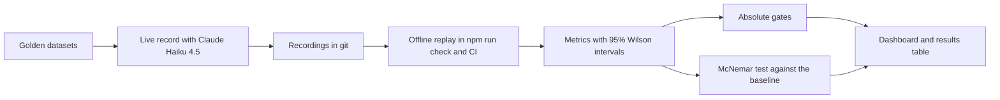
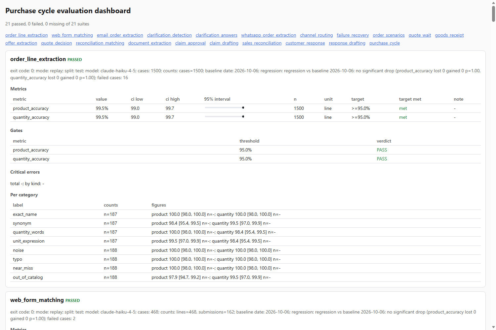
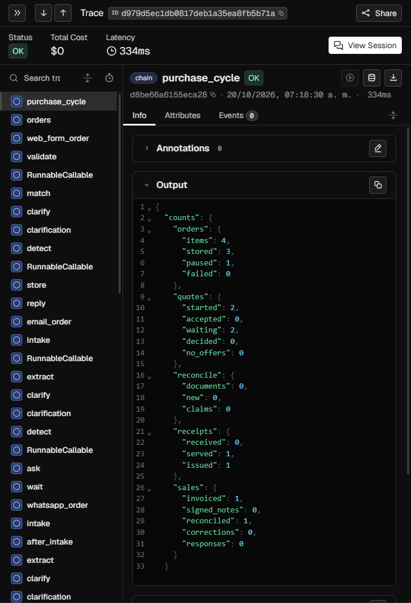
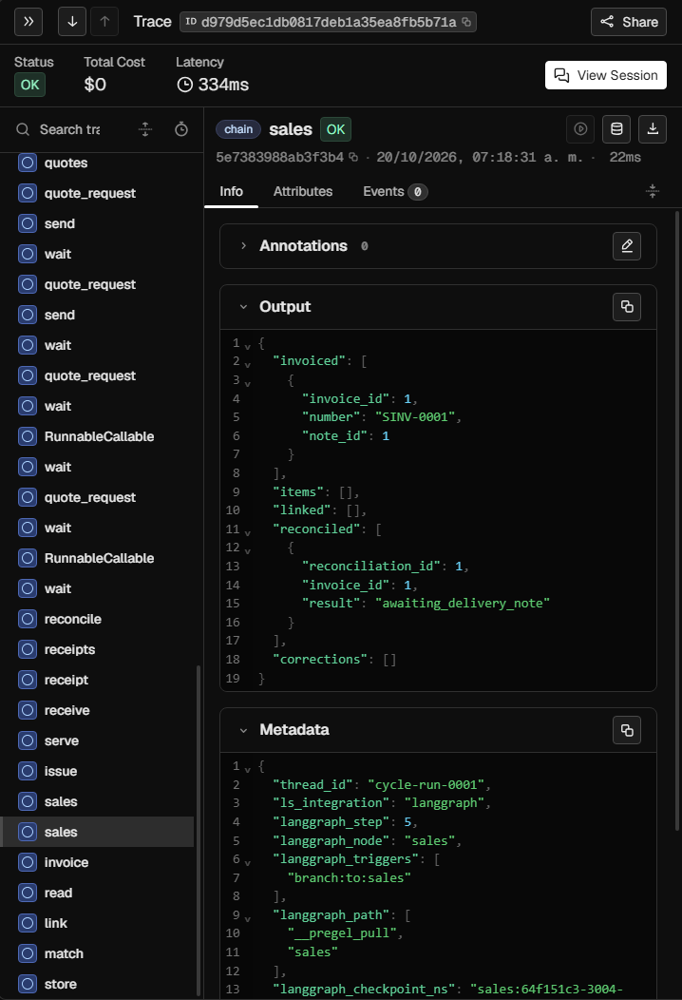
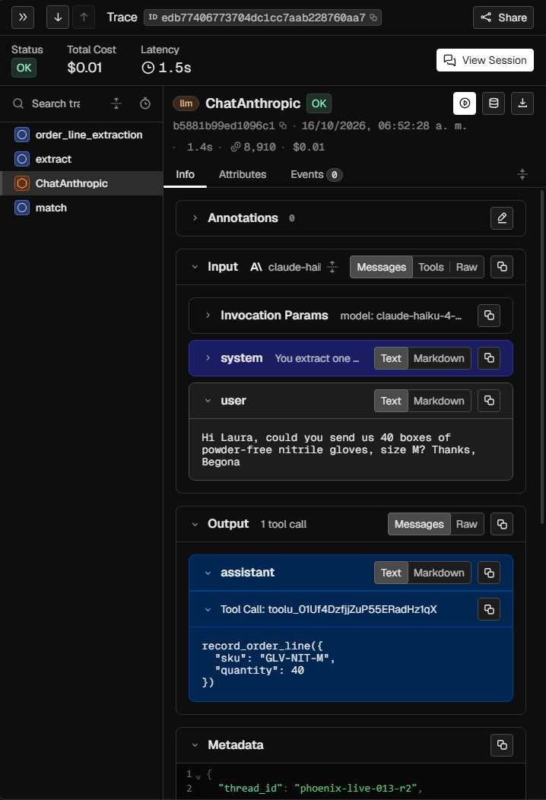
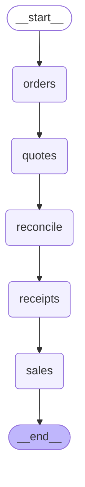

# Full Purchase Cycle Agents

A showcase of how an LLM project is evaluated: every model step has a golden dataset, metrics with confidence intervals and a regression gate, and a prompt change that makes it worse fails the build.
The setting is a company's purchase cycle: multichannel customer orders, supplier quotes and invoice reconciliation run as LangGraph subgraphs over a shared database, composed by an orchestrator graph, with Claude Haiku 4.5 behind LangChain.

[](https://github.com/mikelju/full-purchase-cycle-agents/actions/workflows/check.yml)

## How the LLM work is evaluated

Every model step has a versioned golden dataset, a live recording made once with Claude Haiku 4.5, and an offline replay that runs inside `npm run check` and in CI with no API key.
Each metric carries a 95% Wilson interval, absolute gates fail the build, and a McNemar test against the stored baseline catches a regression case by case.



## Evaluation results

Generated from the stored summaries by `uv run purchase-cycle results-table`; `npm run check` fails when this table is stale.

<!-- results-table:start -->
| Suite | Cases | Main metric | Value (95% Wilson) | Gate |
|---|---|---|---|---|
| order_line_extraction | 1500 | product_accuracy | 99.5% [99.0, 99.7] | PASS |
| web_form_matching | 468 | line_product_accuracy | 99.6% [98.5, 99.9] | PASS |
| email_order_extraction | 234 | intake_accuracy | 99.1% [96.9, 99.8] | PASS |
| clarification_detection | 150 | recall_ambiguous | 100.0% [93.5, 100.0] | PASS |
| clarification_answers | 156 | resolution_accuracy | 99.5% [97.2, 99.9] | PASS |
| whatsapp_order_extraction | 120 | intake_accuracy | 97.5% [92.9, 99.1] | PASS |
| channel_routing | 47 | route_accuracy | 100.0% [92.4, 100.0] | PASS |
| failure_recovery | 34 | scenario_success | 100.0% [89.8, 100.0] | PASS |
| order_scenarios | 30 | scenario_success | 100.0% [88.6, 100.0] | PASS |
| quote_wait | 24 | scenario_success | 100.0% [86.2, 100.0] | PASS |
| goods_receipt | 40 | scenario_success | 100.0% [91.2, 100.0] | PASS |
| offer_extraction | 90 | offer_accuracy | 100.0% [95.9, 100.0] | PASS |
| quote_decision | 39 | scenario_success | 100.0% [91.0, 100.0] | PASS |
| reconciliation_matching | 58 | case_success | 100.0% [93.8, 100.0] | PASS |
| document_extraction | 90 | kind_accuracy | 100.0% [95.9, 100.0] | PASS |
| claim_approval | 35 | scenario_success | 100.0% [90.1, 100.0] | PASS |
| claim_drafting | 60 | reference_accuracy | 100.0% [94.0, 100.0] | PASS |
| sales_reconciliation | 46 | scenario_success | 100.0% [92.3, 100.0] | PASS |
| customer_response | 40 | scenario_success | 100.0% [91.2, 100.0] | PASS |
| response_drafting | 60 | reference_accuracy | 100.0% [94.0, 100.0] | PASS |
| purchase_cycle | 16 | scenario_success | 100.0% [80.6, 100.0] | PASS |
<!-- results-table:end -->



*The static dashboard of `uv run purchase-cycle dashboard`: status, metrics, gates and per-category figures of the 21 suites.*

## Catching an instruction change

Change 018 changed the instructions behind four suites to fix known defects.
The regression gate compared the new baselines with the old ones case by case and showed what was lost and what was gained, with the exact McNemar p.
This table is the output of `uv run purchase-cycle compare-baselines 636711e` on the versioned baselines.

<!-- before-after:start -->
| Suite | Metric | Unit | Before | After | Lost | Gained | Exact McNemar p |
|---|---|---|---|---|---|---|---|
| claim_drafting | case_pass_rate | claim | 57/60 (95.0%) | 60/60 (100.0%) | 0 | 3 | 0.25 |
| clarification_detection | detection_recall | expected doubt | 141/154 (91.6%) | 153/154 (99.4%) | 0 | 12 | <0.01 |
| document_extraction | exact_match | document | 88/90 (97.8%) | 90/90 (100.0%) | 0 | 2 | 0.50 |
| document_extraction | unit_price_accuracy | document | 65/66 (98.5%) | 66/66 (100.0%) | 0 | 1 | 1.00 |
| email_order_extraction | intake_accuracy | email | 231/234 (98.7%) | 232/234 (99.1%) | 0 | 1 | 1.00 |
| email_order_extraction | line_recall | expected line | 568/586 (96.9%) | 574/586 (98.0%) | 2 | 8 | 0.11 |
<!-- before-after:end -->

The instruction changes were caught and checked this way: the only losses are two expected lines in `email_order_extraction` against eight gained, and the clarification recall gain is significant (p < 0.01).
The wording of the new instructions was informed by the test misses it fixes, so these gains are not a clean held-out estimate; the disclosure is in [change 018](docs/changes/018-known-defects.md).

## Sample traces

Local Phoenix traces (OpenTelemetry).
The first two come from a replay of `cycle-demo`; the third is a model call of a live run stored in the same Phoenix.



*One `cycle-demo` run: the root `purchase_cycle` span with the spans of its stages in the left list and the per-stage counts it returns.*



*The `sales` span of the same run: its output and the LangGraph metadata (thread, step and node); the left list holds the node spans of every stage.*



*A `ChatAnthropic` span of a live run: the user message (the system prompt is collapsed), the structured tool call, the token count and the cost.*

## Stack

- LangChain: `ChatAnthropic` with tool-schema structured output, in `src/purchase_cycle/llm.py`.
- LangGraph: `StateGraph` subgraphs and the orchestrator in `src/purchase_cycle/cycle.py`; `interrupt` pauses for human approval in `src/purchase_cycle/quote_decision.py`; SQLite checkpoints in `src/purchase_cycle/graph.py`.
- LangSmith: `evaluate` experiments and datasets in `src/purchase_cycle/evaluation/harness.py`, plus optional tracing of live runs.
- Phoenix: local OpenTelemetry traces, set up by `configure_phoenix_tracing` in `src/purchase_cycle/config.py`.

## Architecture

The orchestrator runs the five stages in order over one database; every stage is itself a graph.




All thirteen graphs are generated from the code in [docs/graphs.md](docs/graphs.md).
The full manual, with every command and demo, is [docs/guide.md](docs/guide.md).
Material in Spanish: the flow animation [purchase-cycle-flow-es.gif](docs/assets/purchase-cycle-flow-es.gif) and the guides [cycle-demo-visual-es.html](docs/assets/cycle-demo-visual-es.html) and [trace-dashboard-guide-es.html](docs/assets/trace-dashboard-guide-es.html).

## How it is built

The project follows SDD Lite: a master plan, phases with frozen acceptance criteria, autonomous agent execution and adversarial review.
Guardrails live in `.claude/settings.json` and `.claude/hooks/`.
CI runs `npm run check` on every pull request and push to `main`, on Linux, with read-only permissions, no secrets and pinned actions.

## Quickstart

Python 3.13 with uv; network access is needed only to clone and install, and no API key is needed because the model answers are replayed from `evals/recordings/`.

```
git clone https://github.com/mikelju/full-purchase-cycle-agents.git
cd full-purchase-cycle-agents
uv sync
uv run purchase-cycle cycle-demo
```

To run every check, install Node.js 22 and run `npm ci --ignore-scripts` and then `npm run check`.

## Limits

- Data, suppliers, the ERP and the clock are simulated; the datasets are synthetic.
- The recordings come from Claude Haiku 4.5; a prompt or model change needs a new record run, which costs API credit.
- Public LangSmith traces are not published yet.
- It is a portfolio project, not a production system.

## License

[MIT](LICENSE)
