# Graph diagrams

Generated by `uv run purchase-cycle diagrams` from the compiled LangGraph graphs with `get_graph().draw_mermaid()`.
No model is called and nothing here is edited by hand; a test fails when this file differs from the code.

## Orchestrator

Built by `cycle.build_cycle_graph`.

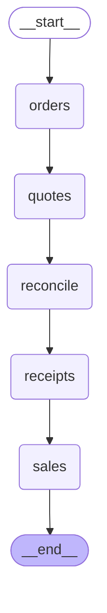

## Order lines

Built by `graph.build_graph`.

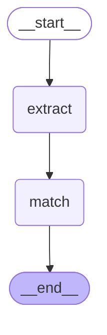

## Web form order

Built by `web_form.build_web_form_graph`.

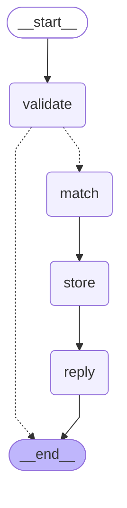

## Email order

Built by `email_order.build_email_order_graph`.

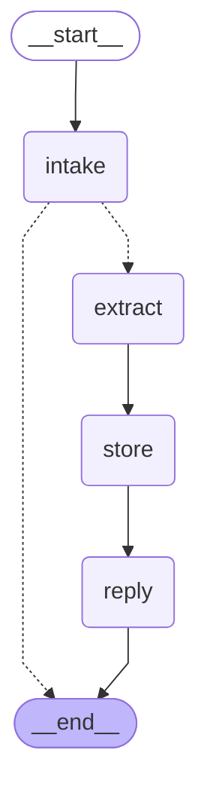

## WhatsApp order

Built by `whatsapp_order.build_whatsapp_order_graph`.

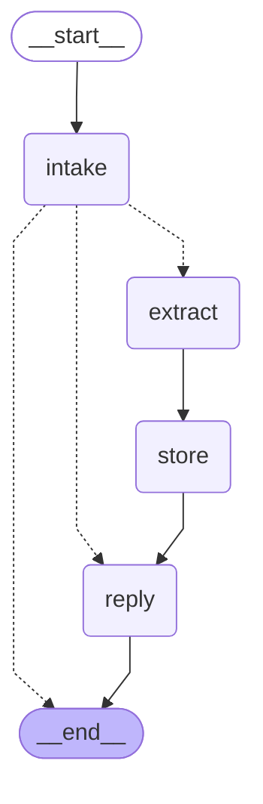

## Clarification

Built by `clarification.build_clarification_graph`.

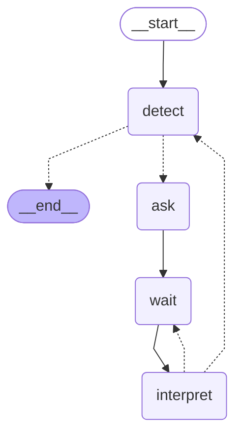

## Quote requests

Built by `quotes.build_quote_request_graph`.

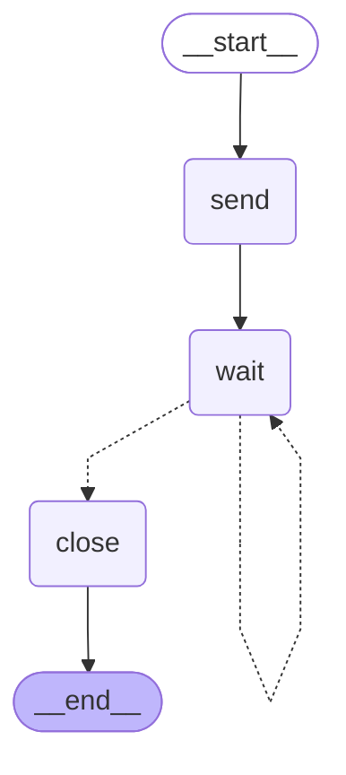

## Quote decision

Built by `quote_decision.build_quote_decision_graph`.

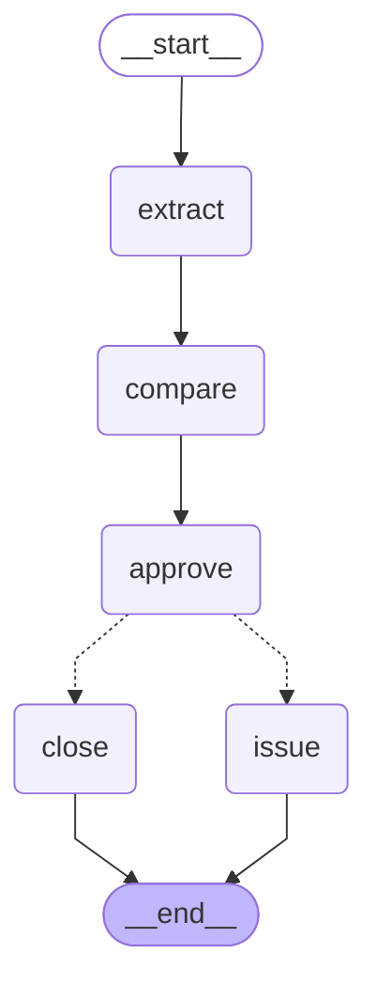

## Supplier reconciliation

Built by `reconciliation.build_reconcile_graph`.

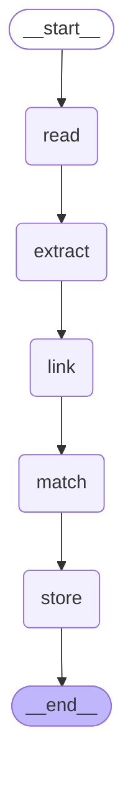

## Supplier claim

Built by `claims.build_claim_graph`.

## Goods receipt

Built by `receipts.build_receipt_graph`.

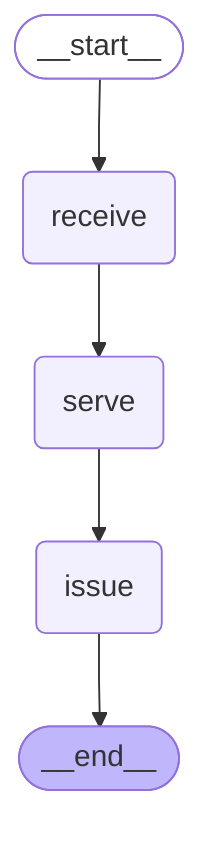

## Sales reconciliation

Built by `sales.build_sales_graph`.

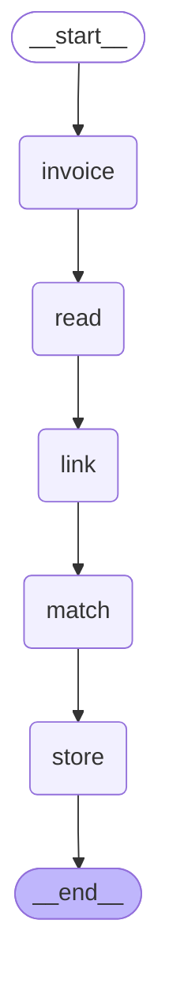

## Customer response

Built by `customer_responses.build_response_graph`.

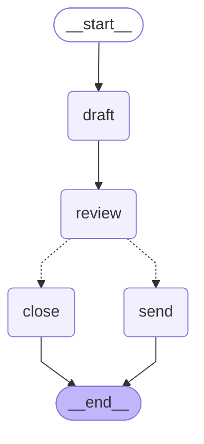
